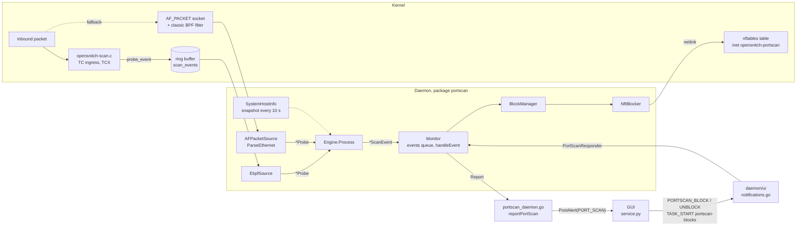
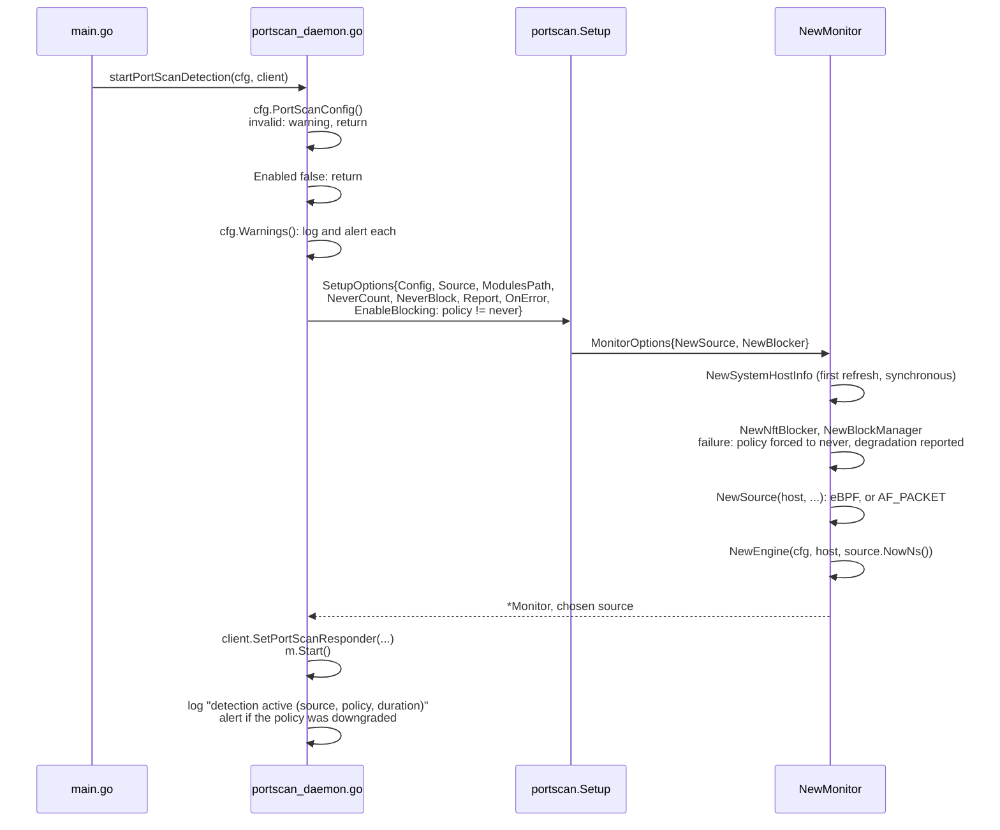
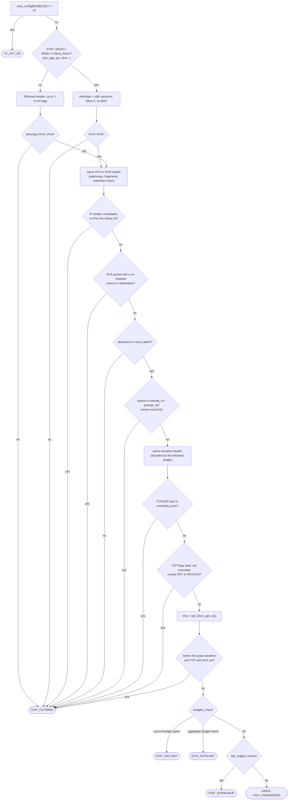
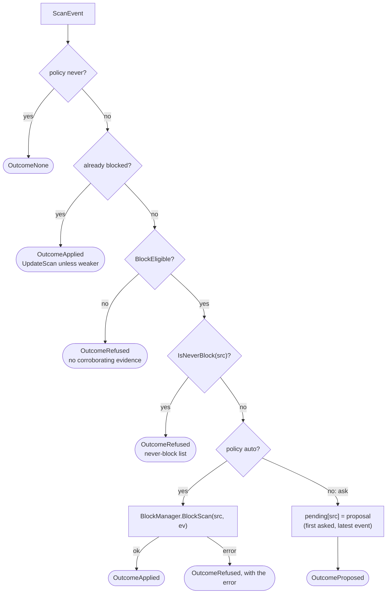
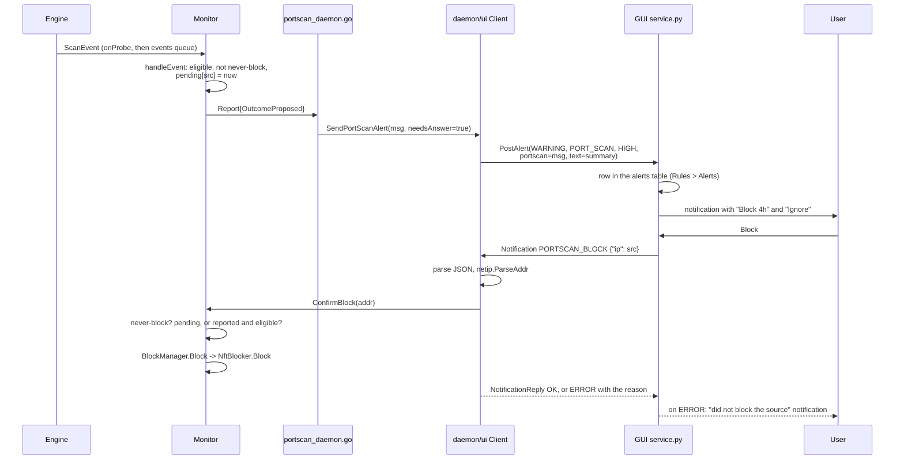
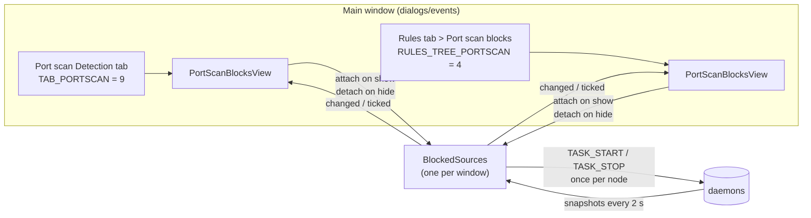
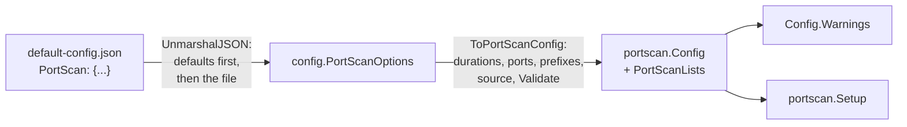

# Port scan detection: how it works

Back to [Port Scan Detection](Port-Scan-Detection).

This page is for people who read or change the code: reviewers of the pull
request, future contributors, and anyone who wants to know how the feature is
built and why it is built that way. It describes the code as it is, file by
file, and names the function behind every statement, so that each one can be
checked. Paths are relative to the repository root. Settings are described from
the user's side on [Settings](Port-Scan-Detection-Settings), costs on
[What It Costs](Port-Scan-Detection-Cost), and what is out of reach on
[Limits](Port-Scan-Detection-Limits).

**Contents**

1. [The pieces and how they connect](#1-the-pieces-and-how-they-connect)
2. [Life cycle: start, reload, stop](#2-life-cycle-start-reload-stop)
3. [The packet path](#3-the-packet-path)
4. [The detection engine](#4-the-detection-engine)
5. [From a crossing to a decision: the monitor](#5-from-a-crossing-to-a-decision-the-monitor)
6. [Blocking](#6-blocking)
7. [The daemon and the GUI](#7-the-daemon-and-the-gui)
8. [Housekeeping and degradation reporting](#8-housekeeping-and-degradation-reporting)
9. [Configuration plumbing](#9-configuration-plumbing)
10. [Trust boundaries](#10-trust-boundaries)
11. [Tests and CI](#11-tests-and-ci)
12. [Design decisions, and the alternatives that were rejected](#12-design-decisions-and-the-alternatives-that-were-rejected)
13. [Changing the code safely](#13-changing-the-code-safely)

---

## 1. The pieces and how they connect

### 1.1 Where the code lives

| Path | Role |
|---|---|
| `ebpf_prog/opensnitch-scan.c` | eBPF program at TC ingress: parses inbound packets, filters, rate-limits, writes probe records to a ring buffer. Never drops a packet. |
| `ebpf_prog/Makefile.scan` | Builds `opensnitch-scan.o` without kernel sources. |
| `daemon/portscan/probe.go` | `Probe`, the one record both packet sources produce; TCP flag and anomaly bits; port classes. |
| `daemon/portscan/parse.go` | The Go packet parser used by the AF_PACKET source. Mirrors the C parser. |
| `daemon/portscan/source_ebpf.go` | Loads and attaches the eBPF program, fills its maps, reads its ring buffer. |
| `daemon/portscan/modulepath.go` | Finds the eBPF object and refuses one that a non-root user could have planted. |
| `daemon/portscan/source_afpacket.go` | The fallback source: AF_PACKET sockets, a classic BPF filter, the same budgets. |
| `daemon/portscan/engine.go` | The detection engine: filters, classification, scoring, reporting decisions. |
| `daemon/portscan/state.go` | Per-source state and the bounded, sharded source table. |
| `daemon/portscan/method.go` | Names the technique from what a source sent. |
| `daemon/portscan/pending.go` | The queue of crossings the alert limiter refused. |
| `daemon/portscan/hostinfo.go` | What the host knows that a network sensor does not: own addresses, listening sockets, connections, gateways, resolvers. Never-count and never-block lists. |
| `daemon/portscan/ephemeral.go` | The host's ephemeral port range. |
| `daemon/portscan/monitor.go` | Wires engine, source, host view and blocker; applies the block policy; periodic maintenance. |
| `daemon/portscan/block.go` | `BlockManager`: the set of blocks, their cap and expiry. |
| `daemon/portscan/history.go` | `History`: the reported sources, with what became of each, kept 7 days so they can be blocked after the fact. |
| `daemon/portscan/blocker_nftables.go` | `NftBlocker`: the nftables table, chain, sets and rules. |
| `daemon/portscan/nft_describe.go` | `NftBlocker.Describe`: the objects that drop one address, read back from the kernel. |
| `daemon/portscan/setup.go` | Chooses the packet source and builds a `Monitor`. |
| `daemon/portscan/config.go` | `Config`, defaults, `Validate`, `Warnings`, scoring weights. |
| `daemon/portscan/protocol.go` | `ScanEvent` to protobuf conversion; stable anomaly identifiers. |
| `daemon/portscan/degraded.go` | The `ErrDegraded` marker for errors the user must hear about. |
| `daemon/portscan/coverage.go` | What can honestly be claimed for each technique, and `RenderCoverage`, which `daemon/portscan/testdata/coverage` runs to generate the [Coverage](Port-Scan-Detection-Coverage) page. |
| `daemon/portscan_daemon.go` | Glue in package `main`: start, reload, stop, alert conversion, the responder the UI client holds. |
| `daemon/ui/config/portscan.go`, `daemon/ui/config/config.go` | JSON form of the settings and its conversion. |
| `daemon/ui/notifications.go`, `daemon/ui/notifications_tasks.go`, `daemon/ui/alerts.go`, `daemon/ui/client.go` | Daemon side of the GUI protocol. |
| `daemon/tasks/portscanblocks/main.go` | Task that streams the list of blocks to the GUI. |
| `daemon/tasks/portscanblocks/info.go` | `Info` and `Scan`: the JSON of one block's details. |
| `proto/ui.proto` | `PortScan` message, `PORT_SCAN` alert, `PORTSCAN_BLOCK`, `PORTSCAN_UNBLOCK` and `PORTSCAN_BLOCK_INFO` actions. |
| `ui/opensnitch/portscan.py` | GUI presenters: alert text, block list and block details parsing, payloads. |
| `ui/opensnitch/service.py` | Receives the alert, shows the notification, sends the user's answer. |
| `ui/opensnitch/dialogs/events/tasks/portscanblocks.py` | `BlockedSources`: the one stream of blocks shared by the GUI views. |
| `ui/opensnitch/customwidgets/portscanblocksview.py` | `PortScanBlocksView`: the table of blocks and detections, with Release, Block and Delete; `PortScanBlockDialog`: the details of one block. |
| `ui/opensnitch/dialogs/events/*.py` | Main window integration: the Port scan Detection tab and the Rules tab entry. |
| `utils/scripts/portscan-real-condition-test.sh` | Real nmap scans of this machine from a network namespace, checked against the daemon's log ([Verifying](Port-Scan-Detection-Verifying#on-your-own-machine-with-real-scans)). |

### 1.2 The whole picture



The split that everything else follows: the kernel program and the AF_PACKET
source only turn packets into `Probe` records; the engine alone decides what
they mean; the monitor alone decides what to do about it; the block manager
alone touches the firewall; the GUI only shows and asks.

### 1.3 Dependency direction

`daemon/portscan` imports `daemon/ui/protocol` (for `ToProtocol`), so
`daemon/ui` cannot import `daemon/portscan` back. The UI client therefore talks
to detection through two small interfaces it declares itself:

- `ui.PortScanResponder` (`daemon/ui/notifications.go`): `ConfirmBlock`,
  `ReleaseBlock`, `Forget`, `DismissProposal`, `BlockedList`, `DetectionList`,
  `BlockInfo`;
- `portscanblocks.Lister` (`daemon/tasks/portscanblocks/main.go`):
  `BlockedList(limit)`, with the optional `DetectionLister`
  (`DetectionList(limit)`).

Package `main` implements the responder in `portScanUIResponder`
(`daemon/portscan_daemon.go`) and hands it to the client with
`SetPortScanResponder`. A configuration reload reaches detection through the
`ui.PortScanReload` hook, set in `daemon/main.go`.

---

## 2. Life cycle: start, reload, stop

### 2.1 Start

`daemon/main.go` calls `startPortScanDetection(cfg, uiClient)` last, after the
firewall and the UI client are up. It never aborts the daemon: every failure is
logged and sent to the GUI as a warning, and the daemon carries on with its
outbound filtering.



Points worth knowing:

- **Order inside `NewMonitor`.** The packet source is built before the engine,
  because the engine must run in the source's clock (`NewEngine(m.cfg, host,
  src.NowNs())`). The eBPF source stamps probes with `bpf_ktime_get_ns()`
  (CLOCK_MONOTONIC since boot); the AF_PACKET source with the time elapsed since
  it was built. `PacketSource.NowNs()` returns "now" in each source's own clock.
- **Failure cleanup.** `NewNftBlocker` installs the nftables table when it is
  constructed. If anything after it fails (no eBPF module and no AF_PACKET, for
  instance), a deferred function in `NewMonitor` stops the block manager, closes
  the source and stops the host view, so nothing is left behind.
- **Policy downgrade.** When the enforcement backend cannot be built (no
  `nf_tables`, no `CAP_NET_ADMIN`, or the table owned by another live instance,
  see [6.3](#63-the-nftables-objects)), `NewMonitor` sets the effective policy
  to `never` and reports a degradation. `startPortScanDetectionMode` compares
  the effective policy with the requested one and sends a separate alert, so
  that the user does not believe blocking is in force.
- **`Monitor.Start`** starts the host view refresh, the block manager's expiry
  loop (every 30 s), the event goroutine, the source's `Run`, and the
  maintenance goroutine (every minute).

### 2.2 Reload

OpenSnitch reloads its configuration on every write of the file.
`Client.reloadConfiguration` (`daemon/ui/config_utils.go`) calls
`ui.PortScanReload`, which runs `reloadPortScanDetection`:

| Situation | Action |
|---|---|
| new configuration invalid | warning, nothing applied, detection keeps running as it was |
| disabled now, running before | `stopPortScanDetection` |
| enabled now, not running | `startPortScanDetection` |
| request identical to the running one | nothing |
| anything else | rebuild: stop, which hands over the blocks in force and the detection history (`StopAndHandOver`, read once the detections still queued are handled, since under `auto` they can block), start again without startup grace (the history is taken over with `ReadoptHistory`), `Readopt` the blocks, then `ReconcileHistory` |

Start, stop and reload each run whole under `portScanLifecycleMu`: a reload
comes from the notification loop (`CHANGE_CONFIG`) or from the watcher of the
configuration file, and a second reload stepping in between the steps of a
first one lost the blocks in force.

"Identical" is `reflect.DeepEqual` on `portScanRequest` (configuration, the two
prefix lists, the source selector, `Ebpf.ModulesPath`): the request as written,
not the effective configuration, which differs from the request on any machine
where the policy was downgraded and would otherwise rebuild detection on every
write of the file.

Detection is rebuilt, never patched: most settings live in the kernel (maps,
TCX attachments) or are read on the packet path without a lock, and a rebuild
cannot leave half a configuration in force. Blocks survive the rebuild with the
time they had left (`BlockManager.Readopt`, [6.2](#62-blockmanager)). The
startup grace is not re-armed on a reload (`startPortScanDetectionMode(...,
restart=true)` sets it to zero): it covers connections opened before anything
watched, which is true once, and re-arming it on each reload would make reloads
an off switch.

### 2.3 Stop

`doCleanup` in `daemon/main.go` calls `stopPortScanDetection()` before
`firewall.Stop()`, while the netlink connection is still usable. It unregisters
the responder first (a `PORTSCAN_BLOCK` arriving afterwards finds nobody), then
`Monitor.Stop`:

1. close the source (`Close` wakes `Run`), and wait for the source goroutine and
   for the event goroutine, which drains its queue so that a crossing already
   accepted still reaches a live firewall;
2. stop the host view;
3. `BlockManager.Stop`: release every block (one transaction per 1024 where
   possible),
   then `NftBlocker.Close`, which deletes the whole table.

`Monitor.Stop` is final: a stopped monitor ignores `Start` and `Release`,
refuses `ConfirmBlock`, and its `BlockManager` refuses `Block`, so a late answer
from a GUI cannot install a block nobody owns.

If the daemon is killed rather than stopped, the kernel removes each blocked
address when its set element times out (the block duration plus five minutes),
and the next daemon start deletes the table left behind
([6.3](#63-the-nftables-objects)): through the blocker's setup when it blocks,
and otherwise, with detection off or the policy `never`, through
`RemoveLeftoverTable`, which deletes the table only when its owner token names
a process that is no longer running, and says so. The check and the deletion
are two transactions, and the netlink library used here (`google/nftables`)
deletes a table by name only: a blocking
daemon starting at the same instant can lose its new table to that deletion,
and gets it back at its next `Repair`, within thirty seconds.

---

## 3. The packet path

### 3.1 One record for two sources

Both sources produce the same `Probe` (`daemon/portscan/probe.go`): a flat
value with the timestamp, source and destination addresses, the link-layer
source address when there is one, the IP protocol, the raw TCP flag octet and
whether it was actually read (`TCPFlagsValid`), the ports, the interface index
and an anomaly bitmask. For ICMP, `DstPort` carries `type<<8 | code`, the
convention of the kernel's connection tracking, so that ICMP is deduplicated
like ports.

Each source reuses a single `Probe` for its whole read loop; a probe passed to
`onProbe` is valid only during the call. The feature's own per-packet code is
written not to allocate: one reused `Probe`, ring buffer records decoded by hand
(`decodeProbeEvent`, no reflection), parse errors defined as values, source
table entries recycled ([4.9](#49-memory-and-concurrency)). A scan event is
allocated only when a source crosses. What the read calls of the libraries
allocate is outside this code.

The anomaly bits are part of the contract between C and Go:

| Bit | Go name | Identifier sent to the GUI | Meaning |
|---|---|---|---|
| 0 | `AnomalyFragment` | `ip-fragment` | non-initial fragment: no transport header, never scored |
| 1 | `AnomalyExtHeaderChain` | `ipv6-extension-header-chain` | IPv6 extension chain beyond the bounded walk, or a jumbogram shape |
| 2 | `AnomalyTruncated` | `truncated-header` | the packet is shorter than its headers claim |
| 3 | `AnomalyNoTCPOptions` | `syn-without-tcp-options` | SYN with no options, as raw packet generators send |
| 4 | `AnomalyFirstFragment` | `ip-first-fragment` | first fragment of a split datagram (nmap `-f`); still counted |
| 5 | `AnomalyVLANDepth` | `vlan-stack-too-deep` | more VLAN tags than the bounded unwrap (two) |
| 6 | `AnomalyTrailer` | `trailing-bytes-after-payload` | bytes after the length the IP header declares; never read |

### 3.2 Source selection

`Setup` (`daemon/portscan/setup.go`) builds the source through `selectSource`:

| `PortScan.Source` | Behaviour |
|---|---|
| `"ebpf"` | eBPF or failure; no fallback, since the operator chose the cost profile |
| `"afpacket"` | AF_PACKET or failure |
| `"auto"` (default) | eBPF; on failure, a degradation is reported and AF_PACKET is tried. If the failure is `ErrNoConfiguredInterface`, there is no fallback: AF_PACKET would fail on the same interface list |
| anything else | refused (the configuration layer refuses it first) |

Every failure of the eBPF module itself is wrapped in `ErrEbpfUnavailable`, so
the choice never depends on matching error text.

### 3.3 The eBPF program

`ebpf_prog/opensnitch-scan.c`, section `tc`, entry point `tc_scan_ingress`,
attached with `link.AttachTCX(... ebpf.AttachTCXIngress)` to every interface
that is up and not loopback, or to the configured list.

**Why TC ingress and not XDP** (from the comment at the top of the file): XDP
falls back to generic mode or is missing on Wi-Fi, tun, bridges and veth, which
a desktop has plenty of, and only one XDP program can own an interface, while
TCX (Linux 6.6) allows several owners on one hook. TC ingress still has the
Ethernet header, so the source MAC can be reported.

**Why the program does not score.** If it did, the scoring would exist twice,
in C and in Go, and the two copies would have to stay identical for the
AF_PACKET fallback to reach the same verdicts. The kernel does the cheap,
per-packet, high-volume work (parse, filter, rate-limit); user space does the
stateful judgement, in one implementation.

**Portability.** The program reads only `struct __sk_buff` (UAPI) and packet
bytes, never a kernel-internal structure. It needs no kernel headers at build
time and one object runs on every kernel that has TCX. `Makefile.scan` builds it
with `-mcpu=v3`: the per-source budget uses atomic instructions that return a
value.

**The program never changes a verdict.** Every path returns `TC_ACT_OK`.
Blocking is done by an nftables rule, which the user can see and audit
([section 6](#6-blocking)).

#### What `tc_scan_ingress` does, in order



Every exit is `TC_ACT_OK`. The order is deliberate: the address-only tests come
before the transport header is read, and the clock is read only after every
structural filter, because `bpf_skb_load_bytes` and `bpf_ktime_get_ns` are
helper calls and most packets need neither.

#### Maps

| Map | Type | Size | Filled by | Purpose |
|---|---|---|---|---|
| `scan_events` | `RINGBUF` | 1 MiB | program | probe records for user space |
| `source_budgets` | `LRU_HASH`, shared by all CPUs | 8192 | program | per-source forwarding budget |
| `global_budget` | `PERCPU_ARRAY` | 1 | program | aggregate forwarding budget, per CPU |
| `local_addrs` | `HASH`, 16-byte key (IPv4 as v4-mapped) | 1024 | daemon | the host's own addresses |
| `l2less_ifaces` | `HASH` | 64 | daemon | interfaces with no link-layer header |
| `exempt_v4`, `exempt_v6` | `LPM_TRIE` | 1024 each | daemon | never-count prefixes |
| `excluded_ports` | `ARRAY` of 1024 `u64` | 65536 bits | daemon | excluded destination ports |
| `scan_config` | `ARRAY` | 8 | daemon | 0 enabled, 1 per-source budget, 2-3 grace deadline, 4 aggregate budget |
| `scan_stats` | `PERCPU_ARRAY` | 8 | program | 0 seen, 1 forwarded, 2 filtered, 3 aggregate refusals, 4 ring buffer full, 5 source refusals |

Details that matter:

- `excluded_ports` is a bitmap in an `ARRAY` rather than a `HASH`: the verifier
  turns an array lookup into direct indexing, where a hash lookup is a call for
  every TCP or UDP packet aimed at the host.
- The exemption trie is chosen by the form of the source address, not by the
  family of the packet (`is_v4_mapped`).
- The grace deadline is absolute, in the clock `bpf_ktime_get_ns()` reads:
  `EbpfSource.configure` writes `NowNs() + StartupGrace`. A duration compared
  with uptime would only have applied during the machine's first minute.
- `EbpfSource.configure` writes `scan_config[ENABLED] = 1` last, so the program
  never runs against half-filled maps: an empty `local_addrs` would discard
  everything, an empty trie would forward what must never be counted.
- Only the never-count list goes to the kernel (`SystemHostInfo.ExemptPrefixes`).
  Filtering never-block addresses there would stop the engine seeing them at
  all ([4.8](#48-the-host-view)).

#### The two budgets

A full port scan would otherwise push 65535 records through the ring buffer,
and a flood of forged sources is a stream of first packets that no per-source
limit bounds. `budgets_check` applies both, in this order:

- **known source** (it has an entry in `source_budgets`): its own budget first,
  `MaxProbesPerSecond` (256) per one-second window, with
  `__sync_fetch_and_add` on the shared entry and a compare-and-swap to roll the
  window (a scan's packets are spread across CPUs by RSS, so plain increments
  would lose counts); then the aggregate. Charging the aggregate first would
  let one flooding address spend it on packets its own budget refuses, and take
  every other source's probes with it.
- **unknown source**: the aggregate first, before the entry is created, so that
  a forged-source flood cannot fill the LRU either.

The aggregate is `MaxTotalPerSecond` (4096) per CPU, so the ceiling is 4096 ×
number of CPUs. `window_rolled` treats a timestamp slightly behind the window
start as cross-CPU skew, not as a new window (rolling on every backward step
handed out a fresh budget several times a second), and a timestamp a whole
window behind as a clock anomaly, which does roll.

The two refusal counters are kept apart (`STAT_SRCLIMIT`, `STAT_RATELIMIT`):
one peer exceeding its own budget costs nobody else anything and is not a
degradation; the aggregate budget refusing probes costs every source,
a real scanner included, and is reported ([section 8](#8-housekeeping-and-degradation-reporting)).

### 3.4 Loading the module safely

`resolveScanModule` and `loadScanModule` (`daemon/portscan/modulepath.go`).

A program at TC ingress sees, and could rewrite or redirect, every inbound
packet, so the object file is treated as code running with the daemon's
privileges:

- **Search order** `/usr/lib/opensnitchd/ebpf`, `/usr/local/lib/opensnitchd/ebpf`,
  `/etc/opensnitchd`. This is not the order of `core.LoadEbpfModule`, which looks
  in `/usr/local` first: on Debian and Ubuntu `/usr/local/lib` is `root:staff
  2775`, writable by the `staff` group, and before packages ship this module a
  file dropped there would often be the only one found.
- **`Ebpf.ModulesPath`**, when set, is the only directory searched, and it is
  verified like the others: the daemon rewrites its configuration file when the
  GUI sends `CHANGE_CONFIG`, over a channel that authenticates nobody.
- **`verifyTrustedPath`**: every path component, from `/` to the file, must be
  owned by root, not be a symbolic link, and not be writable by group or others.
  A module that exists but fails this is refused loudly.
- **No time-of-check to time-of-use gap.** The file is opened with
  `O_NOFOLLOW`, the ownership and mode are checked with `fstat` on the open
  descriptor, and `ebpf.LoadCollectionSpecFromReader` reads that same
  descriptor. What was checked is what is loaded.

### 3.5 The AF_PACKET fallback

`AFPacketSource` (`daemon/portscan/source_afpacket.go`), used when the eBPF path
cannot be (kernel before 6.6, missing module, refused module).

- One `AF_PACKET`, `SOCK_RAW`, `ETH_P_ALL` socket per interface. `SOCK_RAW` and
  not `SOCK_DGRAM`, which would strip the Ethernet header and the source MAC.
- A classic BPF filter, attached before `bind` so no unfiltered packet is
  queued in between: `PACKET_HOST` only, IPv4 or IPv6, directly or behind one or
  two VLAN tags (`ipOnlyFilter`). Interfaces with no hardware address (tun, ppp,
  gre...) carry no link header; they get `ipVersionFilter`, which tests the IP
  version nibble instead, and their frames go to `ParseIP` instead of
  `ParseEthernet`. The filter never looks at the protocol or the TCP flags: no
  technique is filtered out before the parser.
- Snap length `afPacketSnapLen` = 14 + 2×4 + 40 + 1024 + 60 = 1146 bytes: an
  Ethernet header, two VLAN tags, the IPv6 header, the whole bounded extension
  chain and a 60-byte TCP header. Anything the parser accepts fits;
  `TestEveryAcceptedExtensionChainFitsTheSnapLength` holds the two together.
- `SO_RCVTIMEO` of 250 ms: `shutdown(2)` does not wake an AF_PACKET socket, and
  closing a descriptor under a running `recvfrom` risks its number being reused.
  `Close` asks the loops to stop, waits for them, then closes the descriptors.
- **Budgets**, applied after parsing because the per-source one needs the
  address (`admit`): the same per-source budget, 256 per second, in a fixed table
  of 4096 slots where each source may use one of two slots chosen by a seeded
  `maphash`; the same aggregate, 4096 per second for the whole process. A new
  source takes a candidate slot only if it is free or its holder has sent
  nothing for a second; when both are busy, it shares a per-source budget of
  256 per second with the other homeless sources. Refusals are counted under
  the kernel program's names (`rate_limited`, `source_rate_limited`), plus
  `kernel_dropped` from `PACKET_STATISTICS`, so the monitor reads both sources
  alike.

### 3.6 Parsing rules both sides share

`daemon/portscan/parse.go` and the C program implement the same rules, and the
differential tests ([11.2](#112-the-differential-harnesses)) compare them frame
by frame.

- **Declared length, not frame length.** The transport header is bounded by the
  IPv4 Total Length or `40 + Payload Length` for IPv6. Ethernet pads short
  frames, and TC ingress runs before `ip_rcv()` trims that padding: read as TCP,
  zero padding is a NULL scan, and an on-link sender chooses trailer bytes. A
  frame longer than declared sets `AnomalyTrailer`, a shorter one
  `AnomalyTruncated`.
- **Fragments.** A non-initial fragment (offset ≠ 0) has no transport header:
  `AnomalyFragment`, never scored. The first fragment carries the ports and is
  counted, with `AnomalyFirstFragment`; with nmap `-f` the TCP header is cut
  after its first 8 bytes, so the ports are read and `TCPFlagsValid` stays
  false. Flags that were not read are never reported as a NULL scan.
- **IPv6 extension headers.** At most 8 headers (`maxExtHeaders`,
  `MAX_EXT_HEADERS`) and at most 1024 bytes of chain (`maxExtChainBytes`,
  `MAX_EXT_CHAIN_BYTES`); one Destination Options header may declare 2048 bytes,
  so a count alone bounds nothing. Past either bound: `AnomalyExtHeaderChain`
  and no transport header. ESP is not walked (what follows is ciphertext).
  Lengths: Fragment 8, AH `(len+2)*4`, others `(len+1)*8`. Payload Length 0
  with a Hop-by-Hop header (a jumbogram, which Linux produces with BIG TCP) is
  walked on the captured length and flagged.
- **v4-mapped addresses in an IPv6 header** are refused on either side: RFC
  4291 keeps them off the wire and Linux drops such packets, and accepting them
  would let IPv6 packets get an IPv4 address blocked.
- **TCP.** The 13th octet is kept whole: dropping PSH and URG makes an Xmas scan
  look like a FIN scan. A SYN whose data offset is exactly 20 (no options) sets
  `AnomalyNoTCPOptions`. A data offset below 20 or past the end sets
  `AnomalyTruncated`; ports and flags already read are kept.
- **The RST shortcut.** Exactly `RST` or `RST|ACK`, read and neither truncated
  nor trailed, is a rejection and not a probe: dropped in the kernel, and
  ignored by `Engine.classify`. Exactly those two values, because nmap
  `--scanflags ALL` sets RST along with everything else; and only when read,
  because a forged RST in a fragmented scan's padding would otherwise exempt the
  whole scan.

---

## 4. The detection engine

`Engine` (`daemon/portscan/engine.go`) is safe for concurrent use: the AF_PACKET
source calls it from one goroutine per interface. It has no engine-wide lock on
the packet path: `accept` and `classify`, which call into `HostInfo`, run before
any lock is taken, and `Process` then takes only the lock of the shard that owns
the source.

### 4.1 `accept`: what is looked at

In order, a probe is discarded when:

1. the source or destination address is invalid;
2. the source is unspecified, loopback or multicast;
3. the operator named interfaces and this one is not among them
   (`SetAllowedInterfaces`, refreshed when interfaces appear);
4. the destination is not one of the host's own unicast addresses
   (`HostInfo.IsLocalUnicast`): broadcast, multicast and transit traffic go here;
5. the source is on the never-count list (`HostInfo.IsExempt`);
6. it is TCP or UDP to an excluded port (default: 67, 68, 137-139, 546, 547,
   1900, 5353, 5355);
7. it is a non-initial fragment;
8. it is TCP with ACK set, within `StartupGrace` (60 s) of the engine start.

The startup grace exists because, when the daemon starts, packets of
connections opened earlier have no known owner yet and look like probes to
closed ports. Only TCP with ACK can belong to such a connection: a SYN, FIN,
NULL or Xmas cannot, since a peer that believes it has a connection always
acknowledges. Sparing more would leave the first minute after every boot blind
to a SYN sweep. The kernel program applies the same condition.

### 4.2 `classify`: what a probe is worth

| Probe | Counted | Multiplier | Evidence | Reason code |
|---|---|---|---|---|
| IPv6 extension chain exhausted (and TCP or UDP detection on) | yes, every packet (no port to deduplicate) | fixed weight 12 | no | `ipv6-extension-evasion` |
| TCP, exactly RST or RST\|ACK (read, untruncated) | no | | | `tcp-reset` |
| TCP or UDP of a known connection | no; also not fed to the protocol counter | | | `known-connection` |
| TCP, flag octet not read (nmap `-f`) | yes | 3 | yes | `tcp-flags-unreadable` |
| TCP SYN alone, nothing listening | yes | 3 | yes | `syn-closed-port` |
| TCP SYN alone, a service listening | yes | 1 | yes | `syn-open-port` |
| TCP with ACK, to the ephemeral range, nothing listening | no | | | `ack-return-traffic` |
| TCP with ACK, elsewhere | yes | 1 | no | `ack-no-connection` |
| TCP, any other combination (FIN, NULL, Xmas, SYN\|FIN, custom) | yes | 4 | yes | `anomalous-tcp-flags` |
| UDP to 33434-33534 (traceroute) | no | | | `udp-traceroute` |
| UDP, a socket bound | no | | | `udp-open-port` |
| UDP, nothing bound | yes | 1 | no | `udp-closed-port` |
| ICMP timestamp, information or address mask request; ICMPv6 node information query | yes, once per type | fixed weight 40 | no | `icmp-recon` |
| any other ICMP (echo request included) | no score; counts toward the ICMP sweep | | | `icmp-other` |
| any other IP protocol | no score; counts toward the protocol scan | | | `other-protocol` |

The weight of a counted probe is the port class weight times the multiplier
(`ProbeWeight`): 4 for a system port (below 1024, plus a short list of
high-value services registered above it: 1433, 1521, 2375, 2376, 3306, 3389,
5432, 5900, 5901, 6379, 9200, 11211, 27017), 2 for a registered port, 1 for a
dynamic one. A SYN to a closed system port is therefore worth 12.

The ACK rows deserve a word. The connection snapshot is up to ten seconds old,
so the SYN|ACK that opens each outbound connection often arrives before the
connection is in it, on a new ephemeral port every time, which deduplication
cannot absorb: ordinary outbound traffic to one peer would cross the threshold
within the hour. Return traffic arrives at a port this host chose, a scan at
ports the scanner chose; an ACK-bearing packet aimed at the ephemeral range
(read from `/proc/sys/net/ipv4/ip_local_port_range`, `ephemeral.go`) with
nothing listening is therefore not counted. The cost is stated in the code: an
ACK scan confined to the ephemeral range is not detected.

"Evidence" is what `BlockConfig.RequireTCPEvidence` gates on: a probe that only
a scanner sends. TCP carrying ACK (a bare ACK, FIN|ACK) has the shape of return
traffic and a UDP datagram costs nothing to forge, so neither is evidence. The field is named
`HasTCPEvidence` after the setting; it does not mean that TCP arrived.

### 4.3 The score

Per source, `sourceState` (`daemon/portscan/state.go`) keeps a leaky bucket:

- **Decay**: one point per `DecayInterval` (10 s), applied lazily when the
  source sends again (`sourceState.decay`), by whole steps so the remainder is
  not lost, saturating at zero, and guarded against a clock going backwards.
- **Ceiling**: twice the threshold (200), so a long scan cannot bank a score
  that keeps the source hot for hours.
- **Deduplication**: an exact ring of the last 64 accepted `(protocol, port)`
  keys (`portFilterGeneration`). The six SYN retransmissions Linux sends for one
  unanswered connection count once. ICMP is keyed on the type alone. A source
  cycling over more than 64 ports is scored again as it comes round; what stops
  it being reported again and again is the evidence gate of
  [4.6](#46-reporting-cooldown-limiter-queue).
- **Crossing**: `score >= ScoreThreshold` (100), or one of the two detectors
  below.

At the defaults, with no time for decay, a scan crosses after:

| Probes | Weight | Distinct ports to cross |
|---|---|---|
| SYN to closed system ports | 12 | 9 |
| SYN to closed registered ports | 6 | 17 |
| SYN to closed dynamic ports | 3 | 34 |
| FIN, NULL or Xmas to system ports | 16 | 7 |
| UDP to closed system ports | 4 | 25 |
| bare ACK to system ports | 4 | 25 |

The slowest scan each kind of probe can be detected at, within an hour, is
computed by `Config.SlowestDetectableScan` and published on the
[Coverage](Port-Scan-Detection-Coverage) page.

### 4.4 Protocol scans and ICMP sweeps

Two detectors cross on a count of distinct facts rather than on the score:

- **IP protocol scan** (nmap `-sO`): a 256-bit set of the protocol numbers a
  source sent, fed by every accepted probe that is not part of a known
  connection (a peer terminating tunnels legitimately sends ESP, AH, GRE, TCP,
  UDP and ICMP). It crosses at `ProtoScanMinProtocols` (5, psad's value).
- **ICMP sweep** (nmap `-PE -PP -PM`, RFC 7707 probes): a set of the query
  types a source sent: echo, timestamp, information and address mask for IPv4;
  echo and node information query for ICMPv6. Replies and errors never count;
  they are what this host asked for. It crosses at `ICMPSweepMinTypes` (3),
  capped at what the family can produce (4 for IPv4, 2 for IPv6), so one
  setting cannot switch IPv6 detection off.

### 4.5 Evidence and block eligibility

`Engine.blockEligible`: a block may be proposed or applied only if the policy is
not `never` and, when `RequireTCPEvidence` is on (the default), the source has
evidence. Facts age on their own clocks (`Engine.ageFacts`):

- the evidence is forgotten when no evidence probe has arrived for as long as a
  full bucket takes to drain (`ScoreThreshold × DecayInterval`), and whenever
  the bucket empties: a peer whose bucket never empties must not stay blockable
  for good on the strength of one forged packet;
- the protocol and ICMP-type sets are forgotten after `IdleExpiry` (30 min)
  without a new protocol or type, so a slow `-sO` still accumulates while a
  scheduled ping does not.

### 4.6 Reporting: cooldown, limiter, queue

`Engine.shouldReport` decides, once a source has crossed:

1. **Cooldown.** A source reported less than `ReportCooldown` (5 min) ago is
   not reported again, with one exception: a source whose last report could
   not be proposed for blocking (`BlockEligible` false: three ICMP queries, a
   few UDP or ACK probes) is reported again as soon as it can be, skipping
   this step and the next. Otherwise a cheap first report would hold back,
   for the whole cooldown, the question or the block the SYN scan that
   follows it earns. `sourceState.reportedEligible` makes this happen once
   per such report, and the eviction memory keeps it.
2. **Something new.** Past the cooldown, it must have shown more of some kind
   of fact than when it was last reported: more distinct ports (the count is
   clamped to the observed span, so a source cycling over more ports than the
   ring holds cannot inflate it), more protocols, or more ICMP types, each
   against its own baseline (`evidence.isNews`). The cooldown is a timer, not a
   reason.
3. **Alert limiter.** At most `AlertsPerMinute` (3) events per one-minute
   window, globally (`allowEvent`). nmap `-D` makes up to a hundred forged
   sources cross legitimately; without a global cap that is a hundred prompts.
4. **Queue, not silence.** A crossing the limiter refuses is not lost: the event
   is built and queued (`pendingReports`, `pending.go`), and the source does
   not ask the limiter again until the window ends (`suppressedUntilNs`), so the
   "N further alerts were suppressed" figure counts sources, not packets the
   sender chooses. While a source waits, its queued entry is updated each time
   what it has shown doubles. The monitor drains the queue once a minute
   (`DrainPending`), as far as the limiter allows, highest entry first.

The queue is the answer to a specific attack: three forged decoys crossing
first would otherwise buy a real scanner permanent silence, since a finished
scanner sends no further probe to be named by. Its order resists decoys:

- entries are ranked by `Score<<32 | DistinctPorts`, what a crossing cost to
  produce;
- ties are broken by a value drawn from a ChaCha8 generator seeded from
  `crypto/rand` when the entry is first queued, and kept when the entry is
  replaced, so re-queueing cannot re-roll it;
- the queue holds 4096 entries; when full, the lowest entry goes, or a newcomer
  lower than all of them is refused. Neither the address nor the arrival order,
  both chosen by the sender, decides what is reported.

Every event carries `SuppressedSince`, the number of sources silenced since the
previous one, and the GUI says it: without that line the user would believe a
single host is scanning them.

### 4.7 Naming the technique

`describeMethod` (`daemon/portscan/method.go`) works from counts per family
(TCP, UDP, ICMP, protocol scan, extension-header evasion) and from two masks of
the TCP flags seen, their OR and their AND, as scanlogd does:

```text
several families, none dominant .................. mixed
protocol scan .................................... ip-protocol
ICMP sweep ....................................... icmp-sweep
evasion probes the majority ...................... ipv6-extension-evasion
more UDP than TCP ................................ udp
no TCP ........................................... unknown
TCP, flags never readable ........................ tcp-fragmented
TCP, OR != AND (the combination varied) .......... tcp-mixed-flags
TCP, constant combination:
    SYN ................ tcp-syn       (nmap -sS or -sT)
    FIN ................ tcp-fin
    none ............... tcp-null
    FIN|PSH|URG ........ tcp-xmas
    FIN|ACK ............ tcp-maimon
    ACK ................ tcp-ack       (-sA and -sW are identical on the wire)
    SYN|FIN ............ tcp-syn-fin
    all six ............ tcp-full-xmas
    URG|PSH|SYN|FIN .... tcp-os-fingerprint
    anything else ...... tcp-custom-flags, with the bits
```

A family is dominant when every other family contributed at most one probe in
total: one extra datagram must not turn "TCP SYN scan" into "several techniques
combined". These identifiers are stable; values are added, never repurposed.

The same two masks give the event's `flags_summary`, in scanlogd's compact form
(`FlagsString`): one character per bit in header order (FIN, SYN, RST, PSH,
ACK, URG, ECE, CWR), uppercase when set on every probe, lowercase when never
set, `?` when it varied, so `??r?a?ec` for an `-sS` followed by an `-sX`. The
field keeps that form for the protocol's sake; what the user reads is a
sentence made by the GUI (`PortScanPresenter.flags_text`, in the
notification and the details): "SYN", or "FIN, SYN, PSH, URG, varying from
probe to probe", preceded by "ACK on every probe; " when some bits never
changed. The GUI shows any other form of the field cleaned, as it came.

### 4.8 The host view

`SystemHostInfo` (`daemon/portscan/hostinfo.go`) answers the engine's questions
from a snapshot refreshed every 10 seconds, never from `/proc` on the packet
path. The first refresh is synchronous, so the engine never starts on an empty
view.

| Question | Source | Notes |
|---|---|---|
| own unicast addresses | `net.Interfaces()` | a failure to read them is fatal: without them every packet is discarded |
| on-link prefixes | interface addresses | decides whether the source MAC is the scanner's own or a router's |
| listening sockets | `/proc/net/{tcp,tcp6,udp,udp6}` | a socket with no peer, plus the local port of every connected socket |
| known connections | same files | keyed `(proto, remote, remote port, local, local port)`, capped at 65536; overflow is reported |
| gateways | `/proc/net/route`, `/proc/net/ipv6_route` | every next hop, not only the default route's |
| resolvers | `/etc/resolv.conf`, `/run/systemd/resolve/resolv.conf`, `/run/resolvconf/resolv.conf` | at most 64, shared out between the files |

A read that breaks off replaces nothing: a partial socket table would make
return traffic of live connections score, and a partial resolver list would
look complete. The gateways and resolvers are remembered with a fading edge:
each address stays protected for five minutes after it was last seen
(`infraRetention`), because during a DHCP renewal or a VPN switch the default
route is withdrawn and reinstalled, and a snapshot taken in between would
protect neither the old gateway nor the new one.

Two lists answer two different questions, and must not be conflated:

| | never-count (`IsExempt`) | never-block (`IsNeverBlock`) |
|---|---|---|
| effect | the source is not scored at all; also filtered in the kernel | detection continues; no firewall rule may be installed |
| mandatory | 127.0.0.0/8, ::1, 224.0.0.0/4, ff00::/8, 255.255.255.255 | everything never-count holds, plus 169.254.0.0/16 and fe80::/10 |
| derived | the host's own addresses | the host's own addresses, gateways and resolvers (5 min memory) |
| operator | `PortScan.NeverCount` (a `/0` is refused) | `PortScan.Block.NeverBlock` (a `/0` is accepted: alert only) |

Link-local ranges are never-block but not never-count: scanning a neighbour by
its link-local address is ordinary on IPv6, and that on-link attacker is the one
for whom the reported MAC means something. A gateway is never blocked, but a
gateway that really scans is still worth knowing about. Every predicate
normalises its argument first (`normalizeAddr`: unmapped, zone removed),
because `netip.Prefix.Contains` is false for any zoned address while nftables
would drop it.

### 4.9 Memory and concurrency

The source table is bounded by `MaxSources` (4096) and its shape is chosen
against an attacker who controls source addresses:

- **Shards.** A power of two, at most 16, with at least 128 entries per shard;
  each has its own lock, so a flood on one core does not stall the others. The
  shard of an address comes from a hash seeded from `crypto/rand` at start,
  finished with splitmix64: with a fixed hash, forged sources could be aimed at
  one shard and evict a scanner from it for a fraction of `MaxSources`.
- **No allocation on admission.** Entries are carved from slabs of 64 and
  recycled through a free list. An idle desktop pays for the sources it has
  seen, not for the maximum; once the table has been filled, admitting a source
  allocates nothing. The monitor's own estimate of a full table is 288 bytes per
  source (`approxTableBytes`), about 1.1 MB at the default `MaxSources`.
- **Eviction is not plain LRU.** Strict LRU is a bypass: forged sources
  interleaved between a scanner's probes push it out and it comes back with a
  blank score each time. `evictOne` looks at the 8 least recently used entries
  and discards the one with the lowest score as of now (decayed). A source that
  was reported, or that is a running protocol scan or ICMP sweep, ranks above
  any score for as long as its decayed rank is not zero; ties go to the least
  recently used. A bounded table cannot close this bypass entirely, since whoever
  presents more distinct sources than it holds can displace anything; eviction
  sets the price (a little more than one full table of forged packets per hidden probe) and
  `EvictionPressure` reports when someone pays it.
- **Reports outlive their entries.** Each shard remembers, for 64 addresses,
  that they were reported (and when) or refused by the limiter
  (`reportMemo`), never their score. An evicted source that comes back is still
  in its cooldown; without this, one forged probe would evict a reported
  source and it would re-alert 200 ms later against a cooldown of an hour.
- **Idle expiry.** `Expire`, once a minute, walks from the least recently used
  end and stops at the first live entry, so its cost is proportional to what it
  removes.

---

## 5. From a crossing to a decision: the monitor

`Monitor` (`daemon/portscan/monitor.go`).

**Off the packet path.** `onProbe` runs on the goroutine that drains the ring
buffer (or on an AF_PACKET read loop). When `Engine.Process` returns an event,
`onProbe` only queues it on a 64-slot channel; if the channel is full, the event
is counted and dropped. Acting on it takes the block manager's lock and a
netlink round trip, about a thousand times a probe's cost, during which the
kernel would drop whatever it could not fit in the ring buffer, at the moment
someone is scanning. Crossings are capped by the limiter, so a full queue means
the firewall is not keeping up, and that is reported.

**`handleEvent`**, on the event goroutine, decides the outcome:



Every outcome is reported (`ReportFunc`). The glue in `portscan_daemon.go`
logs one line per event and sends the alert; only `OutcomeProposed` is sent at
`HIGH` priority, the others at `MEDIUM`: marking every scan as needing an
answer would train the user to dismiss them.

The packet sources sit before netfilter, so a blocked source is still seen and
scored; when it crosses again, the "already blocked" branch, tested before
any other, reports it as applied, and the block takes the new event as its
scan (`UpdateScan`) unless it is weaker than the one the block shows, without
being extended. A source blocked by force and detected again without
evidence therefore stays `blocked`, not `refused`.

**Answers from the GUI.** A proposal waits in `pending` for ten minutes
(`pendingTTL`); after that the scan is long over and blocking would surprise the
user. Nothing happens on timeout: blocking when nobody answers would reopen what
`ask` exists to close. A `proposal` keeps the time the question was first asked,
which a source still scanning cannot push back, and the latest `ScanEvent` for
the source, which the block keeps if the user accepts it.

`ConfirmBlock(addr)` re-validates everything, because the request comes over a
socket the daemon does not control:

1. the policy must not be `never`, and the monitor must not be stopped;
2. the never-block list is consulted first, so an exempt address is refused as
   exempt (`ErrExempt`);
3. if the address was not pending, it is accepted only if this engine reported
   it and it is block-eligible under the current policy
   (`Engine.LookupForBlock`). The raw score cannot decide this: one forged
   packet makes it non-zero, and a reported protocol scan has none;
4. `BlockManager.BlockScan(addr, "confirmed by the user", scan)`, where `scan`
   is the proposal's event (nil for an address that was not pending), which
   checks the never-block list again at the bottom.

`Release(addr)` reports whether there was a block. Only a real release forgets
the source's engine state (`Engine.Forget`): forgetting it for any address
would let whoever reaches the socket keep a scanner below the threshold with a
release now and then, and keeping it after a genuine release would leave the
source one probe away from another block. `Forget` also takes the source out
of the report queue ([4.6](#46-reporting-cooldown-limiter-queue)): a crossing
queued before the release would otherwise block it again at the next drain,
under the policy `auto`, with no packet from it since.

---

## 6. Blocking

### 6.1 Who owns a block

The daemon, never the GUI. A rule installed by the GUI would outlive the GUI,
and a headless machine would have no enforcement at all. The GUI only sends the
user's answer.

### 6.2 `BlockManager`

`daemon/portscan/block.go`. Three properties are not negotiable:

- **blocks expire**: `ExpireDue`, every 30 seconds, releases what is due, and
  also any block whose address has become never-block since (the exemption was
  checked against a snapshot up to ten seconds old, and a block installed on
  the gateway during a DHCP renewal must not last hours);
- **the number of blocks is capped** (`Block.MaxBlockedSources`, 128): at the
  cap, the oldest block is released to make room, so a decoy scan with a hundred
  forged sources cannot install a hundred rules;
- **a never-block address cannot be blocked**, whatever the caller: the check is
  in `Block` itself, below every path that leads there.

Failure handling follows one rule: the manager's bookkeeping must match what is
really in the firewall.

- `Block` installs first and evicts only on success; evicting first would lose a
  real block for every backend error. If the eviction fails, the new address is
  taken back out; if that fails too, the manager records it as expired at the
  back of the list, marks itself over the cap, and refuses new blocks until a
  release succeeds.
- An entry is forgotten only when the backend confirms the release. A refused
  release is kept, marked `ReleaseFailed`, retried on every pass, reported as a
  degradation, and shown as stuck in the GUI rather than as expiring.
- Releases are batched where the backend allows it (`ManyUnblocker`): each
  nftables commit is serialised per network namespace, and a hundred individual
  releases held the machine's firewall for most of a second.
- `Readopt`, after a reload, replays the previous blocks oldest first, with the
  time they had left (cut to the new `Block.Duration` if shorter), skipping the
  expired and the now-exempt.
- **Each block keeps the scan behind it.** `BlockScan(addr, reason, scan)`
  stores the `ScanEvent` with the entry (`Block` is `BlockScan` with none), so
  the GUI can show the method, the hardware address and the ports long after
  the alert is gone. The event is shared, not copied: nothing modifies a
  `ScanEvent` once the engine has emitted it. Extending a block, or a new
  detection of the blocked source (`UpdateScan`), replaces it only with a newer
  one, never with nil, and `Readopt` carries it across a reload. A block
  confirmed after its question expired takes the scan from the history
  (section 6.4); a block has no scan only when it was confirmed for a source
  the engine still held but the history no longer did. The memory it adds is
  bounded by `MaxBlockedSources`, like the entries themselves.

### 6.3 The nftables objects

`NftBlocker` (`daemon/portscan/blocker_nftables.go`) owns one table and nothing
else:

```text
table inet opensnitch-portscan
├── set portscan_sources_v4   type ipv4_addr, timeout = Block.Duration + 5 min
├── set portscan_sources_v6   type ipv6_addr, timeout = Block.Duration + 5 min
└── chain portscan-input      type filter, hook input, priority filter - 10, policy accept
    ├── rule: meta nfproto ipv4, ip saddr @portscan_sources_v4, drop
    └── rule: meta nfproto ipv6, ip6 saddr @portscan_sources_v6, drop
        (each rule's user data: "opensnitch: port scan source" + owner token)
```

- **A set and two static rules**, not a rule per address: blocking is a set
  element operation and the rule list never churns.
- **Kernel-side timeout** of the block duration plus five minutes: the daemon,
  which can tell the user, normally expires a block itself; the kernel is the
  safety net for a daemon that was killed.
- **Policy accept**: this chain exists to drop the sources in its sets. A drop
  policy would turn enabling scan detection into a default-deny input firewall.
- **Priority `filter - 10`**: a blocked source is dropped before any chain at
  the usual `filter` priority has to look at it, while the administrator's own
  filter table stays in charge of everything else. The rules do not log.
- **nftables whatever `Firewall` says.** OpenSnitch may drive iptables for
  interception; this feature always uses nftables, in its own table.
- **Ownership.** The user data of both rules carries a token naming the process
  that installed them: boot id, PID and process start time (field 22 of
  `/proc/<pid>/stat`), which together survive PID reuse. A daemon that does
  not block deletes such a table too, when its owner is gone
  (`RemoveLeftoverTable`, [2.3](#23-stop)). At setup, a table of
  the same name owned by a live process is left alone and setup fails
  (`ErrTableOwnedByLiveInstance`); `NewMonitor` then runs detection without
  blocking and says so. A table left by a process that is gone is deleted and
  recreated, not adopted: `AddRule` appends, so adopting would add two rules on
  every start, and its elements are drops this process knows nothing about.
- **Repair.** `nft flush ruleset` is the first line of nearly every
  `/etc/nftables.conf`, so `systemctl restart nftables` removes the table. The
  blocker keeps what it believes is installed (`live`, each address with its
  deadline). `Repair`, called at the start of every `ExpireDue` pass, checks that
  the table exists with both rules (`nft flush table` leaves the table but
  removes the rules) and otherwise rebuilds everything, reinstalling every live
  element with its remaining time: the objects and the first 1024 elements in
  one transaction, the rest in transactions of 1024 (`unblockBatch`), each as
  one element list per set. One message per element lost its acknowledgements
  from a few hundred blocks, and the commit never returned with the blocker's
  lock held. `Block` does the same when its commit fails with `ENOENT`. The
  gap lasts at most one 30-second pass.
- **Release** forgets the address in `live` first and unconditionally, so a
  rebuild never reinstalls something the caller asked to release. A missing
  element is not an error: the kernel timeout may have won the race.
  `UnblockMany` releases in transactions of 1024 (`unblockBatch`). A set's
  element list is one netlink attribute with a 16-bit length, which the
  netlink library truncates without an error: past 4095 IPv4 or 2340 IPv6
  deletions, and 2340 IPv4 or 1638 IPv6 additions with a timeout, the kernel
  handled none or part of the list and mostly answered success. One element
  already gone fails a whole deletion with `ENOENT`; the batch is then
  released address by address, where absence is no error.
- **Close** deletes the table by name, whether or not setup completed.
- **Describe** (`nft_describe.go`) renders, for one address, what drops it, in
  the syntax of `nft list table`: its set, with that address as the only element
  shown (its own timeout when it differs from the set's, as after a rebuild,
  and the time left), and the chain with the rule that looks the set up. All of
  it is read from the kernel at the time of the call, not from `live`: a view
  that rendered what the daemon believes would show a rule someone deleted. An
  element, rule or table that is gone is an error saying which
  (`ErrNotInFirewall` for the element). Only the rule shape `setupLocked`
  installs is rendered; the chain is listed in the kernel's order, and any
  other rule is shown at its place as a comment with its handle, not
  interpreted, with a warning when one comes before the drop, since it may
  accept the address first. `Describe` reads on a netlink connection of its
  own, one request at a time (`describeMu`), and does not hold the blocker's
  lock: dumping a set at the largest `MaxBlockedSources` takes over a second,
  and blocks and releases must not wait for it.
  `nft_describe_live_test.go` compares the output with what the `nft` command
  lists for the same table.

### 6.4 The detection history

A scan is reconnaissance: the attempt on a service it found can come hours or
days later, long after the alert is gone and its question has expired. The
monitor keeps every reported source in a `History` (`history.go`): one entry
per address, with its latest `ScanEvent`, when it was first and last reported,
and what became of it (`DetectionStatus`):

| Status | Set by |
|---|---|
| `detected` | `handleEvent`, policy `never` |
| `asked` | `handleEvent`, policy `ask` |
| `unanswered` | `expirePending`, after `pendingTTL` (10 min) |
| `ignored` | `DismissProposal`, for a question still open |
| `refused` | `handleEvent`: not eligible, exempt, or the backend failed; `Reason` holds the daemon's words |
| `blocked` | `handleEvent` (policy `auto`, or already blocked), `ConfirmBlockForce` |
| `released` | `Release` |

A source stays `HistoryRetention` (7 days) after its latest detection; at most
`MaxHistory` (512) are kept, since a decoy scan reports a source per decoy.
When the history is full, a new detection takes the place of the oldest one
*without TCP evidence* that the user has not acted on (blocked or released),
or is not kept at all (`makeRoomLocked`). A detection with TCP evidence is
never pushed out by a newer one, since those can be forged as well as UDP,
with SYNs to closed ports (9 per source cross the threshold): a scanner
flooding the history after its scan would otherwise erase it at the pace
the alert limiter allows, about three hours at the default `AlertsPerMinute`.
A full history stops keeping new detections until entries age out; the
detections are still reported as alerts, and the monitor warns, at most
once an hour unless the count grows tenfold, with every detection not kept
since the previous warning (`checkHistoryFull`, from the cumulative
`History.Dropped`). An attacker can fill the history ahead of
a scan, loudly, but cannot empty it of one. For the same reason a detection
without TCP evidence never replaces one with it in the source's entry: the
entry keeps its scan and its date, so that its retention runs from it and an
old accusation is neither kept alive nor shown as new by later UDP, from the
scanner or forged with its address; only a question really asked on it is
recorded.

One entry per address is a choice, not a shortcut: block, release and status
belong to an address, and an entry per technique would give one address
several rows with contradictory statuses and actions, and divide by the
number of techniques what `MaxHistory` holds against a decoy flood. Successive
techniques from one source therefore do not add entries. They seldom produce
a distinct `ScanEvent` either: the method is named from the source's
accumulated state (family counts, flag masks; [4.7](#47-naming-the-technique)),
kept until `IdleExpiry` of silence, so a second technique turns the name into
`tcp-mixed-flags` or `mixed`; and the engine reports the source again only past
the cooldown and with something new ([4.6](#46-reporting-cooldown-limiter-queue)),
so a technique run within the cooldown is not reported at all, unless it is
the first that makes the source blockable. Past it, the
first probe of a new technique usually is: the first report goes out at the
crossing, about nine ports in, and the rest of a fast scan is new against
it. A timeline of techniques per source was considered and left out: it would
change when the engine re-reports a source, the history, the protocol and the
details dialog, for an information the blocking decision does not need. The
alerts (**Rules** › **Alerts**) keep the text of each report the GUI received,
in memory unless its database is set to a file.

The history is in memory. Stopping the monitor sets it aside
(`portScanHistory` in `portscan_daemon.go`, from `StopAndHandOver`, which
reads it after `Stop` has handled the detections still queued) and the next monitor takes it over
(`ReadoptHistory`, which turns an open question into `unanswered`, the new
monitor not having asked it): a configuration reload keeps it, and so does
turning detection off and on again. A restart of the daemon starts it empty.
After a reload, `ReconcileHistory` marks `refused` an entry still saying
`blocked` whose block was not carried over because the address is now on the
never-block list.

`ConfirmBlockForce(addr, force)` blocks a source after the fact. Not a reply to
an open question, the request is honoured only for a source the engine still
holds or the history does: a message on the socket must not be a way to drop
any address. Eligibility is judged by the configuration in force when the
user blocks (`EligibleNow`: `HasTCPEvidence`, unless `RequireTCPEvidence` is
off), not taken from the record: a detection made under the policy `never`
is recorded as not eligible, and one made before `RequireTCPEvidence` was
turned on as eligible. A source whose detection is not eligible (no
corroborating evidence, its address may be forged) is blocked only with
`force`, which the GUI sends after a warning, and the block's reason says so;
without it the answer is `ErrNotEligible`. A block or a release, and the
status the history records for it, are one step (`blockOpMu`, also held
while a detection is decided), so concurrent requests cannot leave the
history saying the opposite of the firewall. The never-block list is checked
first and is never overridden, `force` or not; the policy `never` refuses
every block, as before. A request for a source already blocked is answered
OK and does not extend the block. `ConfirmBlock(addr)` is
`ConfirmBlockForce(addr, false)`.

`Monitor.Forget(addr)` removes a source from the list at the user's request
(`PORTSCAN_UNBLOCK` with `"forget": true`, the GUI's *Delete*): its block is
released if it has one (`Release`), then, under `blockOpMu`, an open question
about it is dropped and its history entry deleted (`History.Remove`). A source
blocked again in between keeps its entry and its block. For a source that was
not blocked, the engine's state is kept, as on a release of nothing:
forgetting it for any listed address would let whoever reaches the socket
keep a scanner below the threshold with a deletion now and then. A released
one is forgotten by `Release`, as for any genuine release, and the log says
the block was released. The answer is ERROR when the daemon lists neither a
block nor a detection for the address, and on a stopped monitor: during a
reload its blocks have already been handed to the next one, which would put
back the block just deleted. The GUI reads the rows' kinds from the stream
again after the confirmation, and does not delete one that became a block
meanwhile.

---

## 7. The daemon and the GUI

### 7.1 Protocol additions

In OpenSnitch the GUI is the gRPC server and the daemon the client. Alerts go
from the daemon to the GUI through the `PostAlert` RPC; the GUI sends commands
to the daemon on the `Notifications` stream, which the daemon answers with
`NotificationReply` messages carrying the same id. The feature adds
(`proto/ui.proto`):

- `Alert.What.PORT_SCAN = 7`;
- `Alert.portscan = 12`, a `PortScan` message, **outside** the existing
  `oneof data`. The oneof carries a one-line summary in `text`
  (`portScanSummary`, `daemon/ui/alerts.go`), which is all a GUI that predates
  the feature can show; inside the oneof, such a GUI would have received an
  empty alert;
- `message PortScan` (22 fields, filled by `ToProtocol`): the source address,
  the MAC and whether it is the source's own, the method identifier and its
  description, the flag summary, port counts, range and sample, protocols,
  score, interface, targeted local addresses, first and last seen, anomaly
  identifiers, evidence, eligibility, `suppressed_since`, and the block
  duration in seconds (a `uint32`, which is one reason `Block.Duration` is
  capped at 30 days);
- `Action.PORTSCAN_BLOCK = 15`, data `{"ip": "...", "dismiss": false}`;
  `dismiss: true` answers "Ignore"; `"force": true` blocks a source of the
  history whose detection is not enough on its own (section 6.4);
- `Action.PORTSCAN_UNBLOCK = 16`, data `{"ip": "..."}`; `"forget": true`
  removes the source from the list instead (section 6.4);
- `Action.PORTSCAN_BLOCK_INFO = 17`, data `{"ip": "..."}`, answered with the
  details of that block, or of that source of the history, in the reply's
  `data` (section 7.3).

The block duration is the node's, never the GUI's. Both Python bindings are
committed (`ui/opensnitch/proto/ui_pb2.py` for protobuf ≥ 4,
`ui/opensnitch/proto/pre3200/ui_pb2.py` for older runtimes), regenerated with the
compiler each generation came from; `ui/opensnitch/PORTSCAN-BUILD.md` explains
why the compiler version matters.

### 7.2 A scan under the `ask` policy, end to end



On the GUI side (`ui/opensnitch/service.py`, `_on_port_scan_alert`), the alert
is always written to the alerts table, even with notifications turned off. A
notification with buttons is shown only when the alert needs an answer
(`block_eligible` and priority `HIGH`) and the notification server supports
actions. Otherwise the notification is a plain one; when an answer was needed
but the server cannot show buttons, it adds that the scan could not be offered
for blocking, and where the blocks are listed. Any answer other than Block is sent
as `dismiss`. A refusal from the daemon is shown as a notification of its own:
sent without a callback, a refusal would be dropped and the user would believe
the source blocked.

**Everything shown comes off a socket.** In multi-node mode the GUI listens on
TCP and renders interface names chosen by whoever is root on the reporting host,
and notification bodies are rendered as markup. `PortScanPresenter._clean`
therefore bounds every field (64 characters, 8 anomalies, 4 targets, a 4096
character body) and replaces any character outside a small set
(`[^\w .:+/\[\]-]`) before escaping what is left. Method and anomaly labels come
from tables that a test checks against the Go identifiers, in both directions.

### 7.3 Listing and releasing blocks

The list is a task, because `TASK_START` is how OpenSnitch already streams live
data to the GUI: the reply stream stays open, keyed on the notification id, and
each tick pushes a new snapshot (`daemon/tasks/portscanblocks/main.go`):

```json
{"blocks": [{"addr": "192.0.2.66", "reason": "confirmed by the user",
             "expires_at": 1758648000, "blocked_at": 1758633600,
             "remaining": 14250}],
 "total": 1, "omitted": 0,
 "detections": [{"addr": "192.0.2.70", "method": "tcp-xmas",
                 "method_detail": "TCP Xmas scan (equivalent to nmap -sX)",
                 "status": "unanswered", "first_reported": 1758640000,
                 "last_reported": 1758644000, "eligible": true}],
 "detections_total": 1, "can_block": true}
```

- most recent first, at most 512 entries (`MaxEntries`), with the total and the
  number left out; `blocks` is never `null`;
- `remaining` is computed on the daemon's clock and sent with the absolute
  expiry, because the GUI may run on another host whose clock is off;
  `"stuck": true` marks a block the firewall refused to release;
- `blocked_at` is when the block was installed or last extended (the order of
  the list); a configuration reload keeps it, since it is not a new block;
- the interval comes from the GUI and is bounded to 500 ms to 5 min, since it
  arrives over an unauthenticated socket and every tick marshals a snapshot;
- when detection is not running, the task refuses to start, and a snapshot
  that cannot be read becomes an error on the stream, never an empty list:
  "nothing is blocked" and "nothing is watching" look identical in a table and
  mean opposite things;
- the task reads the responder again for every snapshot (`portScanLister`),
  so it follows detection through a reload;
- `detections` is the history (section 6.4) without the sources blocked right
  now, which are listed as blocks; a `blocked` entry whose block has ended is
  sent as `ended` (it expired, was evicted by `MaxBlockedSources`, or a reload
  did not carry it over: the daemon does not record which). `eligible` says
  whether a block needs `force`, judged by the configuration in force,
  `exempt` that the source is on the never-block list, and `can_block` that
  the node can block at all (false under the policy `never`). A full history
  is a quarter of a megabyte, so a stream sends the detections only when they
  changed: otherwise the key is absent and `detections_unchanged` is true, and
  the GUI keeps the list it last received on that stream. A daemon that
  predates the history sends no `detections` key, and the GUI says nothing
  about detections for it;
- `TaskManager.AddTask` refuses a second task with the same name, and the
  task's `Start` does nothing if its `Stop` came first (a `TASK_STOP` can
  overtake the goroutine that starts the task).

`PORTSCAN_UNBLOCK` calls `ReleaseBlock`; the daemon answers ERROR when there was
nothing to release, so the GUI never reports a release that did not happen.
With `"forget": true` it calls `Forget`, and answers ERROR when the daemon
lists the address neither as a block nor as a detection. A daemon that
predates the field ignores it and only releases.

`PORTSCAN_BLOCK_INFO` answers OK with one block in detail
(`portscanblocks.Info`), or, for a source of the history that is not blocked,
its scan and a `detection` object, the row of the list, with no `firewall`;
ERROR when the address is neither:

```json
{"addr": "192.0.2.66",
 "reason": "TCP SYN scan (equivalent to nmap -sS, or to the -sT connect scan)",
 "expires_at": 1758648000,
 "remaining": 14250,
 "scan": {"method": "tcp-syn",
          "method_detail": "TCP SYN scan (equivalent to nmap -sS, or to the -sT connect scan)",
          "src_mac": "02:00:00:00:00:01", "src_mac_is_source_own": true,
          "flags_summary": "fSrpauec", "distinct_ports": 300, "min_port": 1,
          "max_port": 300, "sample_ports": [21, 22, 80, 443], "protocols": 1,
          "score": 120, "interface": "eth0", "targets": ["192.0.2.1"],
          "first_seen_unixnano": 1758634000000000000,
          "last_seen_unixnano": 1758634003000000000,
          "anomalies": [], "has_tcp_evidence": true},
 "firewall": "table inet opensnitch-portscan {\n\tset portscan_sources_v4 {..."}
```

- `scan` uses the field names of the `PortScan` message, and is built by
  `ToProtocol`, the conversion the alert uses, so the two cannot disagree;
  `portscan_blockinfo_test.go` gives every field a distinct value and checks
  each one lands under its own name. It is absent when the
  block has no scan (section 6.2).
- `sample_ports` is what the engine keeps: the first 16 distinct ports a source
  probed (`sampledPorts`), so the full list only for a scan of 16 ports or
  fewer. A source's state is a fixed-size
  value so that the table's memory is bounded whatever the sources send; a full
  port set would be 8 KiB per source.
- `firewall` is `NftBlocker.Describe` at the time of the request; when it
  fails, `firewall_error` says why and the rest of the answer is still sent.
- The details are asked for when the user opens them, not pushed with every
  snapshot: they are several times the size of a row, and reading the firewall
  takes several netlink dumps per request.

### 7.4 Where the GUI shows the blocks



- **One stream, two views.** A node runs one `portscan-blocks` task at a time,
  so the two views cannot each open their own: `BlockedSources`
  (`ui/opensnitch/dialogs/events/tasks/portscanblocks.py`) opens one per node
  while at least one view is visible, and both views render from it. The tab
  shows the blocks and the detections not blocked (section 6.4) in one list,
  most recent first: a block by `blocked_at`, a detection by `last_reported`
  (`BlockedSources.rows`, a stable sort, so rows of the same second keep the
  daemon's order). Listed after the blocks, a scan reported after them showed
  below older ones. From a daemon that does not send `blocked_at`, blocks
  stay first. The Rules view, which lists what the firewall enforces, is
  built with `detections=False` and shows the blocks only. The *Status* column says
  `blocked`, or what became of a detection (`not blocked: no answer`,
  `not blocked: ignored`, `not blocked: refused`, `block released`,
  `block ended`, `detected; blocking is off`); the *Scan or reason* column
  gives the scan type and, for a refusal, the daemon's reason.
- **Stopping is deferred** by one turn of the event loop. Qt hides the page
  being left before it shows the one being entered; stopping at once would send
  `TASK_STOP` then `TASK_START` when the user merely switched from one view to
  the other.
- **The countdown** is decremented locally between snapshots, from the time the
  last one arrived. A node silent for more than three intervals (6 s) has its
  rows withdrawn and named as stale; a node that never answers is named as one
  whose daemon may not support the feature, rather than shown as blocking
  nothing; until a node has answered, it is listed as loading, and the list
  does not say that nothing is blocked. Disconnections and reconnections of
  nodes are followed.
- **Replies are attributed by request, and checked against their stream.**
  The GUI service hands a reply over with the daemon's gRPC peer without its
  protocol prefix (`/local` for the node `unix:/local`), so `BlockedSources`
  takes the node from its own record of the request a reply answers (`_sent`
  for the list, `_releases` for a release). The id alone is not enough: the
  daemon that replies chooses it, and ids are timestamps, easy to guess, so one
  node could otherwise answer for another, rewriting its list or putting an
  address of its choosing under its name. `_reply_is_from` therefore accepts a
  reply only if the address it came with is the one `Nodes.get_addr` gives for
  the node it was asked of. The one exception is the answer
  `Nodes.send_notification` gives itself, from inside the call, for a node that
  is not connected: it carries the node's full key, which no daemon's stream
  can produce. `Nodes.reply_notification` applies the same check
  (`Nodes.reply_is_from`) to the one-time requests of this feature
  (`PORTSCAN_BLOCK`, `PORTSCAN_UNBLOCK`, `PORTSCAN_BLOCK_INFO`), before it
  forgets their id: another node answering first would otherwise consume the
  id, and the real answer, a refusal, would be lost, in the views and in the
  desktop prompt alike.
- **Rendering is coalesced.** A node can answer on its stream as often as it
  likes, and a table of a thousand rows rebuilt per answer would freeze the
  GUI at a few answers a second. The first push after a quiet spell is rendered at
  once, the next ones at most every `RENDER_INTERVAL_MS` (250 ms), the last
  one always; a view in an inactive tab of a window on screen (the Rules
  tab's, most of the time) renders when it is shown.
- **The selection follows rows, not row numbers.** A render clears the
  selection and selects again the rows whose (node, address) were selected,
  all of them, in one change, and keeps the current row, from which
  Shift+click and the keyboard extend the selection, on its (node, address)
  too, without scrolling the list. A row that left the list, or that the
  filter hides, leaves nothing selected, and no current row, in its place, so
  a push never puts under Release, Delete or Block a row the user did not
  select, whatever a node does to its own rows in between.
- **A node is what the GUI calls a node.** The check above can only separate
  daemons that the GUI itself keeps apart, and the GUI's node identity is
  upstream's, which this feature does not change. `Nodes.get_addr` drops the
  port, so two daemons behind the same IPv4 address, or two clients of the
  same unix socket, are one node; and it cuts an IPv6 peer
  (`ipv6:%5B2001:db8::2%5D:port`) at its first colon, so every IPv6 daemon
  whose address starts with the same group is one node too. Within such a
  merged node, one daemon can answer for another, here as everywhere else in
  the GUI. The IPv6 truncation is an upstream defect, reported and fixed
  separately from this feature.
- **Release** asks for confirmation, sends one `PORTSCAN_UNBLOCK` per selected
  row to the node that holds the block, and reports a refusal; a success needs
  no message, since the row disappears on the next snapshot.
- **Delete** (the Delete key, or the context menu), in the Port scan Detection
  tab only, asks for confirmation, naming the blocked rows it will release,
  and sends `PORTSCAN_UNBLOCK` with `"forget": true` per selected row
  (`BlockedSources.delete`). A refusal is reported; one saying "not blocked"
  comes from a daemon that predates deletion, and the GUI says so. In the
  Rules view, which lists blocks only, the Delete key still releases.
- **Block** is offered for a selected detection, unless it is exempt or its
  node cannot block (`can_block`). It asks for confirmation, with a warning
  naming the sources whose detection is not enough on its own, and sends
  `PORTSCAN_BLOCK` with `force` for those only. The answer is routed like a
  release (`_blocks`, `_inflight_block`, `_reply_is_from`); a refusal is
  reported, a success shows as the row moving to the blocks. The targets,
  and whether each needs `force`, are fixed before the question, from the
  feed rather than from the rows on screen: snapshots keep arriving while the
  box is open, and what is sent is what the user confirmed. The details
  dialog of a detection has a *Block* button that goes through the same
  confirmation; the Rules view gives it none.
- **Times from a node are bounded** (`BlockedListPresenter.unix_time`,
  `BlockInfoPresenter._unixnano`) and rendered by `when_text`, which never
  raises: an `OverflowError` from `time.localtime` in a slot would abort the
  whole GUI. A details request unanswered after `INFO_TIMEOUT` (10 s), as from
  a daemon that predates `PORTSCAN_BLOCK_INFO`, is given up and the dialog
  says so.
- **Details.** A double-click on a row, or *Details* in its context menu, opens
  `PortScanBlockDialog` on its *Scan* tab; *Show nftables rule* opens it on its
  *nftables rule* tab. The dialog asks the node with
  `BlockedSources.request_info`, which sends `PORTSCAN_BLOCK_INFO` and answers
  with the `info_received` signal; Refresh asks again. The answer is routed like
  a release: by the request's own record (`_infos`), checked with
  `_reply_is_from`, with `_inflight_info` for the synchronous answer about a
  node that is not connected, and an error for every request still waiting when
  its node disconnects, so no dialog stays on "Loading..." for good. An answer
  about another address than the one asked is refused.
  `BlockInfoPresenter` parses it with the same rules as the list: addresses
  validated, every string bounded and cleaned, ports kept only if they are
  integers in range, control characters removed from the nftables text, and
  everything rendered as plain text. The hardware address is labelled as the
  source's own only when the daemon says so, and otherwise as the last
  router's; the port sample is labelled as such when it is shorter than the
  count. The scan type is the daemon's `method_detail` when it starts with the
  GUI's label for the method, which every `ScanMethod.Description()` does
  (`test_portscan.py` reads them from `method.go`), so it is shown once with
  its nmap options. It is cleaned with an allowlist of its own, which keeps
  parentheses, commas and semicolons and allows 256 characters: the alert's,
  made for markup, turned them into "?" and cut the longest in half. Under the nftables text, the dialog explains why the element's
  `expires` runs past the countdown of the list: the set's timeout is the
  block duration plus five minutes (section 6.3), a safety net the daemon
  normally never reaches. The text does not state the margin, which is the
  daemon's to choose.
- **The tab has no SQL view.** Every other tab of the main window is a view of
  a table in the GUI's database; this one is a widget fed by the daemon, so
  `TABLES[TAB_PORTSCAN]['view']` is `None` and the code that refreshes,
  filters, limits or cleans "the active table" skips it. The window's search
  field filters the list. `TAB_FIREWALL` and `TAB_ALERTS`, which are not real
  tabs and must come after every tab, moved from 9 and 10 to 10 and 11.
- **A block is not an OpenSnitch rule**, and the view says where it lives: the
  nftables table and the two set names, which a test reads from the Go source.

---

## 8. Housekeeping and degradation reporting

`Monitor.maintenance` runs every minute:

| Step | Why |
|---|---|
| `Engine.Expire` | drop sources idle longer than `IdleExpiry` |
| `expirePending` | forget proposals older than ten minutes |
| `RefreshWallClockAnchor` | probe times are CLOCK_MONOTONIC, which stops during suspend; without re-anchoring, alert times drift by the total time slept |
| `syncSourceAddrs` | push the host's current addresses to the eBPF map (additions before removals; stale entries removed even when an addition fails, so a full map does not stay full) |
| `refreshSourceInterfaces` | attach to interfaces that appeared (a VPN, a container bridge), release those that went; said out loud |
| `checkSourceDegradation` | report rises of `ringbuf_full`, `kernel_dropped` and `rate_limited`; not `source_rate_limited` |
| `checkEvictionPressure` | report two or more full turnovers of the source table in a minute |
| `checkDroppedEvents` | report crossings dropped because the event queue was full |
| `checkHostView` | report a host with no address of its own: detection is blind |
| `DrainPending` | report queued crossings the limiter now allows |

Because the kernel's copy of the host's addresses is synchronised once a
minute, an address that appears (a DHCP change, an IPv6 privacy address) is
watched on the eBPF path within a minute; the engine's own view follows within
ten seconds.

**Which errors reach the user.** An error wrapping `ErrDegraded`
(`degraded.go`) means the feature runs with less protection than configured: no
enforcement backend, an incomplete never-block list, a blind host view, lost
probes, a block that could not be released, a fallback to the slower source.
`OnError` logs every error, and the daemon sends the degradations to the GUI as
warnings (`portscan.IsDegradation`); per-packet noise stays in the log. A
sentinel and not message matching: matching text drifted and let every one of
them through as noise.

**Pacing.** A condition that lasts was said every minute, and one warning a
minute teaches the user to ignore them all. `sayLocked` gives each kind of
warning at most once an hour, and again sooner if its size has grown tenfold;
every paced warning ends with a sentence saying so, so that its silence is not
read as the condition having ended.

---

## 9. Configuration plumbing



- `Config.PortScan` is a pointer: an absent key means the shipped defaults,
  which have `Enabled: false`. An OpenSnitch upgrade must not start attaching
  programs nobody asked for.
- `PortScanOptions.UnmarshalJSON` fills the defaults (`DefaultPortScanOptions`,
  derived from `portscan.DefaultConfig`, so the two cannot drift) and overlays
  what the file says: `{"PortScan": {"Enabled": true}}` is a complete
  configuration.
- `ExcludedPorts` and `Block.MaxBlockedSources` are pointers, so an explicit
  `[]` or `0` means what it says instead of being replaced by the default.
- Durations are strings (`"10s"`, `"4h"`); an empty string keeps the default, a
  malformed one is an error naming the field.
- Prefixes must parse and must not have host bits set (`192.168.1.5/24` is
  refused with both possible corrections in the message); `NeverCount` refuses
  `/0`, which would switch detection off for a whole family while the daemon
  reported it active.
- `Config.Validate` refuses out-of-range values rather than clamping them: a
  silently corrected threshold is one the operator believes is in force. The
  bounds sit where arithmetic built on the values would overflow or where the
  value stops meaning anything (for example `ProtoScanMinProtocols` ≤ 256, since
  there are 256 protocol numbers).
- `Config.Warnings` lists values that are valid but switch detection off or
  remove a protection (a grace above ten minutes, a decay above five minutes,
  a threshold above 10000, more than 20 alerts a minute, `auto` without
  `RequireTCPEvidence`). They are logged and sent to the GUI at every start.

---

## 10. Trust boundaries

| Input | Who controls it | What the code does about it |
|---|---|---|
| inbound packets | anyone who can reach the host; source addresses are forgeable | the source is never called the attacker; the default policy asks; blocking needs evidence a forged datagram cannot supply; never-block lists for the host's own infrastructure; a cap on blocks; blocks expire; per-source and aggregate budgets in both sources; bounded parsing; bounded, sharded, seeded state; a decoy-resistant alert queue |
| messages from the GUI | the GUI socket authenticates nobody, and may be TCP in multi-node mode | addresses parsed as `netip.Addr` before anything else; `ConfirmBlock` accepts only a pending or reported source (in the engine or the detection history), eligible under the configuration in force unless `force` is given, and never a never-block one; the task interval is bounded; snapshots are bounded |
| replies from one daemon, in the GUI | any connected node | a reply counts only on the stream of the node it was asked of (`_reply_is_from`); daemons the GUI merges into one node are not told apart ([7.4](#74-where-the-gui-shows-the-blocks)) |
| messages from a daemon, in the GUI | whoever is root on a reporting node | every field bounded and neutralised before display; addresses validated before a release can be sent |
| the configuration file | root, and the GUI through `CHANGE_CONFIG` | strict validation; `Ebpf.ModulesPath` verified like the default paths |
| the eBPF object file | whoever can write its directory | root-owned, non-writable path to the file; loaded from the verified descriptor |
| the nftables table | root, `nft flush ruleset`, a second daemon | own table, policy accept, ownership token, periodic repair, kernel-side timeout |

---

## 11. Tests and CI

### 11.1 Where the tests are

| Location | What it covers |
|---|---|
| `daemon/portscan/*_test.go` | engine, parser, sources, host view, block manager, nftables backend, monitor, configuration, method naming, protocol conversion, the detection history and blocking after the fact (`history_test.go`), and regression tests |
| `daemon/portscan_daemon_test.go`, `daemon/portscan_blockinfo_test.go` | the glue: never-block list passed to `Setup`, blocks released at stop, reload without grace keeping the blocks, a `ModulesPath` change noticed; the details of a block keep every `PortScan` field under its own name; the history sent without the blocked sources, an ended block as `ended` |
| `daemon/ui/config/portscan_test.go` | JSON to configuration: defaults overlay, every field reachable from JSON with a non-default value, bad values refused, off unless asked for |
| `daemon/ui/alerts_portscan_test.go`, `daemon/ui/portscan_blocks_wiring_test.go` | alert summary; the task wired through `TaskManager` to the stream; `PORTSCAN_BLOCK_INFO` answered with JSON, or with an error; `force` carried to the monitor; the detections listed |
| `daemon/tasks/portscanblocks/main_test.go` | interval parsing, snapshot shape and bound, a failing lister reported, a stop before start |
| `ui/tests/test_portscan.py` | presenters; identifiers and JSON keys read from the Go source, not copied |
| `ui/tests/dialogs/test_portscanblocks.py` | the views, the shared stream, the details dialog, the detection history and Block with its warning, and the real main window |
| `proto/check_portscan_bindings.py`, `proto/run_binding_check.sh` | the Go binding and both Python generations agree on the wire |

### 11.2 The differential harnesses

Two parsers are supposed to agree by construction, and a fix applied to one of
them only, as a security fix easily is, would leave the two paths detecting
different things: a LAN scan with `nmap -f -sS` could score zero on the default
path while the fallback reports it. Two harnesses hold them together:

- **`daemon/portscan/testdata/cparse/`** compiles `ebpf_prog/opensnitch-scan.c`
  unmodified, natively, against two small headers that stand in for libbpf, and
  runs the real program frame by frame. `cparse_test.go` feeds the same frames
  to the C program and to the Go parser and compares the records field by field
  (the C records also go through `decodeProbeEvent`, which checks the
  hand-written offsets).
- **The nmap corpus** (`testdata/generate_corpus.sh`, 21 captures of real nmap
  runs) is replayed through the engine by `differential_test.go`, which checks
  that the technique named is the one nmap was asked for: the expectation comes
  from the nmap command line, not from this package.

### 11.3 Tests against the real system

These need privileges and build their own isolated environment:

- `testdata/run_nft_test.sh`: real nftables rules in a network namespace,
  including `Describe` compared with what `nft` lists;
- `testdata/run_live_test.sh`: a real nmap scan through the AF_PACKET source;
- `testdata/vm/run_vm_test.sh <capture>`: boots a throwaway VM, loads the real
  object, attaches it through TCX, replays a capture onto a veth pair, and
  follows the detection to a real nftables rule and back to nothing at shutdown.

Tests that need something missing skip and say so; the `PORTSCAN_REQUIRE_*`
environment variables (`_CPARSE`, `_CORPUS`, `_NFT`, `_LIVE`, `_EBPF`, `_BOTH`)
turn those skips into failures, and each CI job or script sets the ones that
apply to it.

### 11.4 CI

`.github/workflows/portscan.yml` runs seven jobs on changes to these paths:
unit and race tests with `go vet`, gofmt, staticcheck and the C/Go
differential; the corpus generated on the runner and replayed; a live
AF_PACKET scan; real nftables rules; building and loading the eBPF object; the
protobuf bindings cross-check; and the GUI tests under `QT_QPA_PLATFORM=offscreen`.

---

## 12. Design decisions, and the alternatives that were rejected

| Decision | Rejected alternative | Why |
|---|---|---|
| Score in user space only | score in the eBPF program (flowhawk) | one implementation of the judgement; the fallback reaches the same verdicts by construction |
| TC ingress with TCX | XDP | XDP runs in generic mode, or not at all, on Wi-Fi, tun, bridges and veth; only one XDP program can own an interface, where TCX allows several |
| Block with nftables | drop in the eBPF program | the user can see, audit and undo a firewall rule; an invisible drop inside a BPF program cannot be |
| A set with timeouts and two rules | one rule per address | no rule churn; a killed daemon's blocks still expire |
| Policy `ask` by default | `auto` | the source of a scan is chosen by its sender; scanlogd, PortSentry and psad all refuse automatic blocking by default for that reason |
| Evidence required to block | block on any crossing | a UDP or ACK source costs nothing to forge |
| Leaky bucket | fixed window (scanlogd) | a fixed window misses any scan slower than itself; a bucket keeps a trace at constant memory |
| Exact deduplication ring | a probabilistic filter | a new port must never be mistaken for a repeat; fixed size either way |
| Ranked eviction, report memory | plain LRU | LRU lets interleaved forged sources reset a scanner's score |
| Queue refused alerts | drop them | three decoys would otherwise silence a real scan for good |
| Host knowledge (sockets, connections) | flag heuristics only | scanlogd and PortSentry discard every ACK and RST because they cannot look; a host can |
| Daemon owns blocks | GUI installs rules | rules would outlive the GUI; headless nodes would have none |
| Off by default | on by default | an upgrade must not start attaching programs or touching the firewall |
| Validate and refuse | clamp | a corrected threshold is one the operator believes is in force when it is not |

---

## 13. Changing the code safely

Some values are shared between files or languages, and a change on one side
only compiles, passes most tests, and is wrong. The tests that hold each pair
together are named here.

- **A new anomaly bit.** Add it in five places, each held by its own test:
  - `probe.go` (and move `lastAnomalyBit`), and `PROBE_ANOMALY_*` in
    `opensnitch-scan.c`: `TestEveryAnomalyBitExistsOnBothSides`
    (`source_ebpf_test.go`) compares the two;
  - the wire constant `probeAnomaly*` in `source_ebpf.go`:
    `TestEbpfContractConstantsMatchC` compares it with the C source;
  - the mapping in `probeEvent.fill`: `TestFillMapsEveryAnomalyBit`;
  - `anomalyNames` in `protocol.go`: `TestEveryAnomalyBitHasAName`
    (`protocol_test.go`);
  - `PortScanPresenter.ANOMALY_LABELS`: `ui/tests/test_portscan.py`, which reads
    the identifiers from the Go source.

  The shared parser bounds are checked by `TestSharedParserBoundsMatchC`.
- **A new method.** Add the constant, its `String` and `Description`, and its
  GUI label; identifiers are never repurposed.
- **A new setting.** It goes in `portscan.Config`, in
  `config.PortScanOptions`, in `DefaultPortScanOptions` and in
  `ToPortScanConfig`, with bounds in `Validate`. A test must compare the whole
  converted structure: `DetectICMPSweep` once existed in `portscan.Config` and
  not in the JSON form, so it read false on every real daemon while its own tests
  passed.
- **The probe record.** `struct probe_event` and `probeEvent` must keep the same
  packed layout; `TestProbeEventLayout` and the native C harness check the
  offsets in `decodeProbeEvent`.
- **Parsing.** Any change goes in both parsers, with a frame added to the
  differential tests.
- **A new packet-path condition.** Keep the kernel filter and `Engine.accept`
  or `Engine.classify` in step, as the grace and RST rules are.
- **nftables names.** `nftTableName` and the set names are read by the GUI test
  that checks what the view tells the user.
