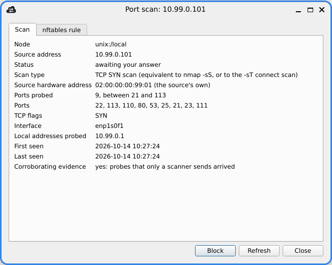
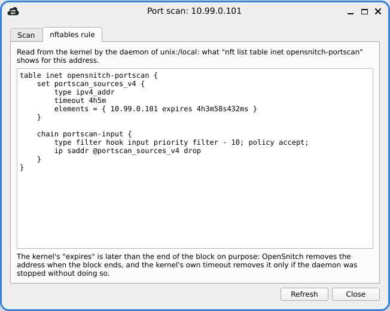

# Port scan detection: settings

Back to [Port Scan Detection](Port-Scan-Detection).

## Every setting

```json
{
  "PortScan": {
    "Enabled": true,
    "Source": "auto",
    "Interfaces": [],

    "DetectTCP": true,
    "DetectUDP": true,
    "DetectProtocolScan": true,
    "DetectICMPSweep": true,

    "ScoreThreshold": 100,
    "DecayInterval": "10s",
    "MaxSources": 4096,
    "IdleExpiry": "30m0s",
    "StartupGrace": "1m0s",
    "ProtoScanMinProtocols": 5,
    "ICMPSweepMinTypes": 3,

    "AlertsPerMinute": 3,
    "ReportCooldown": "5m0s",
    "ExcludedPorts": [67, 68, 137, 138, 139, 546, 547, 1900, 5353, 5355],
    "NeverCount": [],

    "Block": {
      "Policy": "ask",
      "Duration": "4h0m0s",
      "MaxBlockedSources": 128,
      "RequireTCPEvidence": true,
      "NeverBlock": []
    }
  }
}
```

| Setting | Meaning |
|---|---|
| `Source` | `auto` (eBPF, falling back to AF_PACKET), `ebpf` (fail rather than fall back), `afpacket` |
| `Interfaces` | restrict detection; empty means every interface except loopback, including ones that appear later. A named interface that does not exist yet is watched once it appears |
| `ScoreThreshold` | the score at which a source is reported |
| `DecayInterval` | how long one point of score takes to leak away; this sets the slowest scan that can be detected |
| `MaxSources` | how many sources are tracked at once; when full, the weakest of the least recently seen is evicted |
| `IdleExpiry` | a source's state is dropped after this long with no packet |
| `StartupGrace` | for this long after start-up, TCP packets carrying ACK are not counted: they may belong to connections opened before the daemon started. SYN, UDP, ICMP and protocol scans are counted from the first second |
| `ProtoScanMinProtocols` | how many distinct IP protocols from one source count as an `nmap -sO` scan |
| `ICMPSweepMinTypes` | how many distinct ICMP query types from one source count as a host sweep; replies and errors are never counted |
| `DetectICMPSweep` | turns the ICMP host-sweep detector off on its own; it is not accepted as the only detector, since a sweep carries no port evidence |
| `AlertsPerMinute` | caps notifications; the rest are counted and summarised in the next alert |
| `ReportCooldown` | how long before the same source is reported again |
| `ExcludedPorts` | never counted: DHCP, NetBIOS, SSDP, mDNS, LLMNR all naturally touch several ports |
| `NeverCount` | CIDR prefixes whose packets are not watched at all, down to the kernel filter: a scan from them is never reported. Distinct from `Block.NeverBlock`, which keeps detection and only forbids the block. A prefix with host bits set, an IPv4-mapped one (`::ffff:192.0.2.0/120`, which matches no IPv4 source; write `192.0.2.0/24`), or `0.0.0.0/0` and `::/0`, is refused |
| `Block.Policy` | `never`, `ask` (default), `auto` |
| `Block.Duration` | how long a block lasts (default 4 hours) |
| `Block.MaxBlockedSources` | cap on simultaneous blocks; the oldest is released to make room |
| `Block.RequireTCPEvidence` | refuse to block a source that sent nothing only a scanner sends (a SYN, or TCP flags without ACK) |
| `Block.NeverBlock` | extra CIDR prefixes that must never be blocked. As for `NeverCount`, a prefix with host bits set, or an IPv4-mapped one, is refused |

Values out of range are **rejected**, not quietly corrected: a threshold
silently replaced by a default is a threshold you believe is in force when it is
not.

Interface coverage follows the machine. The list is re-evaluated every minute, so
a VPN tunnel that connects after login, a container bridge created on demand, or
a laptop that boots before it associates to Wi-Fi are all picked up, and the
daemon says which interface it has started watching. A list resolved once at
startup would leave a scan arriving over any of those invisible until the
daemon restarts.

The same holds when `Interfaces` names them. With `["eth0", "tun0"]` and the VPN
down at boot, detection starts on `eth0`, says that `tun0` is missing, and
starts watching `tun0` within a minute of it coming up; an interface that goes
away is released. One case is refused rather than guessed: if **none** of the
named interfaces exists, detection does not start, and the daemon says so. A
list that matches nothing is more likely a typo than a plan, and "detection is
running" on no interface at all is the failure this feature exists to avoid.

The eBPF module is looked for in the standard directories, or only in the one
named by `Ebpf.ModulesPath`. That is the existing top-level setting the other
eBPF modules use, not a key under `PortScan`; see
[Port Scan Detection](Port-Scan-Detection).

### Addresses that can never be blocked

Whatever the configuration says, and whatever the GUI asks for, these are never
blocked:

- this host's own addresses;
- `127.0.0.0/8` and `::1/128`;
- `169.254.0.0/16` and `fe80::/10`;
- `224.0.0.0/4`, `ff00::/8` and `255.255.255.255`;
- the next hop of every route (`/proc/net/route`, `/proc/net/ipv6_route`) and
  every DNS resolver listed in `/etc/resolv.conf`,
  `/run/systemd/resolve/resolv.conf` or `/run/resolvconf/resolv.conf`, read
  again every ten seconds.

psad shipped without this check and had to add it afterwards. It is enforced
below every caller, so no path (an automatic decision, a message from the GUI,
a future caller nobody has written yet) can get past it.

The derived half of that list has a five-minute memory rather than being a plain
snapshot. `/proc/net/route` shows the next hops that exist at the instant it is
read, and during a DHCP renewal, a Wi-Fi change or a VPN transition the default
route is withdrawn and reinstalled: a plain snapshot refreshed in between would
see no gateway at all, and for up to ten seconds neither the old one nor the new
one would be protected. An address therefore stays protected for five minutes
after it stops being observed. A block is also re-examined on every expiry pass and released if
its address has since become exempt, so one installed during such a window lasts
at most thirty seconds rather than the full duration.

If one of those files cannot be read in full, the daemon says so through its
error channel and keeps the previous list rather than replacing it with what it
managed to read before the failure. It does not refuse to start: that would hand
anything able to break one of those files (a DHCP server chooses the length of
the `search` line in `resolv.conf`) a way to switch detection off.

## What happens when a scan is detected

You get a notification naming the source address, the technique, how many ports
were probed and over what range, plus any evasion signs. Under the default
policy it also asks whether to block the source; the daemon owns the block, so
closing the GUI never leaves an orphaned firewall rule, and a headless machine
is still protected.


Every detection is also recorded in the main window, under **Rules** ›
**Alerts**, with the full text of the notification.

To see what is blocked, open the **Port scan Detection** tab of the main
window, or select **Port scan blocks** in the tree of the **Rules** tab, next to
the application rules and the system rules. Both list, for every connected
node, each blocked address, its status (`blocked`), why it was blocked and how
long the block has left, and refresh every two seconds; the window's filter
field narrows them like any other view. Select one or more blocks and press
**Release** (or *Release* in the right-click menu; in the Rules tab, the
Delete key too) to lift them before they expire.

In the **Port scan Detection** tab, *Delete* in the right-click menu, or the
Delete key, removes the selected rows, after a confirmation, as it removes a
rule in the Rules tab: a blocked source is released first, as by
**Release**, and the source goes from the daemon's list with the details of
its scan. For a source that was not blocked, the daemon still remembers what
it did recently, so one that scans again is reported when it shows something
new; a released one, as after **Release**, is detected afresh. A row that
becomes a block while you confirm is not deleted, and the GUI says so. A
daemon older than this option only releases, and the GUI says it cannot
delete a detection.

The **Port scan Detection** tab also lists, with the blocks and most recent
first (a block by when it was made, a detection by when it was last reported),
the sources that were detected and are not blocked, with what became of them:
the question is still open (*awaiting your answer*), was not answered in time
(*not blocked: no answer*) or was answered *Ignore* (*not blocked: ignored*),
the daemon refused to block (*not blocked: refused*, with its reason), the
policy is `never` (*detected; blocking is off*), or a block was released
(*block released*) or ended (*block ended*: it expired, was removed to stay
within the maximum number of blocks, or was not carried over when the
configuration was reloaded or detection turned off). A scan is usually reconnaissance: the
source has learned which services listen, and the attempt on one of them may
come hours or days later. Select such a source and press **Block** (or
*Block* in the right-click menu, or the *Block* button of its details) to
block it now, for the configured duration. The daemon keeps these sources for
7 days after their latest detection, at most 512 of them, in memory. When the
list is full, a new detection replaces the oldest one with only forgeable
traffic (UDP, ACK, protocol or ICMP probes) that you have not blocked or
released, or is not kept, and the daemon warns: a flood of forged detections cannot
push a real scan out of the list. The other side of this rule: whoever fills
the list first (512 forged sources take about three hours at the default
`AlertsPerMinute`) keeps the scans that follow out of it for as long as it
stays full. Those scans are still alerted and asked about, and can be blocked
from their alert, but not from the list once the alert is gone. Likewise, on
a network where hundreds of sources are legitimately detected every day, the
list keeps the oldest and stops taking new ones until those age out; the
warning says when this happens. The list survives a configuration reload,
and turning detection off and on again; a restart of the daemon empties it.
The daemon blocks only a source it reported itself, and never one on the
never-block list.


The list has one row per source address, not one per scan: blocking and
releasing act on an address, and two rows for one address could only
contradict each other. When the same machine scans again with another
technique, its row and its details show the latest detection, which replaces
the previous one. What to expect when you run several nmap scans in a row
from one machine:

- **The first alert comes early.** A source is reported as soon as it
  crosses the threshold, after about nine ports, and the row shows the scan
  as it was at that moment: a fast `-sS` of 1000 ports shows 9.
- **Within `ReportCooldown` (5 minutes) of that report, nothing more is
  reported.** A `-sX` run right after a `-sS` gives no alert, and the row
  still says "TCP SYN scan". The one exception: when that report could not
  be blocked (an ICMP sweep, a UDP or ACK scan), the first scan that makes
  the source blockable, a `-sS` for instance, is reported at once.
- **After the cooldown, the first probe that brings anything new reports the
  source again**: new ports, a new protocol or a new ICMP type, compared with
  the previous report. The rest of a fast scan counts, since that report saw
  only its first nine ports: a `-sF` or a `-sX` on the same ports as an
  earlier `-sS`, more than 5 minutes later, gives a new alert.
- **The technique is named from everything the source sent** since the
  daemon started following it, until it has been silent for `IdleExpiry`
  (30 minutes): that new alert says "TCP scan, several flag combinations",
  and a `-sS` followed by a slow `-sU` gives "Several scan techniques
  (combined by one source)", not the second technique alone.
- **A weaker detection does not replace a stronger one.** A detection with
  nothing only a scanner sends (a UDP scan, for example) does not replace one
  that had it: the row keeps the earlier scan and its date. Its status
  changes only if the new detection is asked about, which can happen when
  `Block.RequireTCPEvidence` is off.

The sequence of techniques is not kept. What the decision needs is that the
address scanned this host, and that is known from its first detection. The
alerts the GUI received are in **Rules** › **Alerts**, with the full text of
each notification; they outlive the GUI only if its database is set to a
file in the preferences, and while no GUI is connected the daemon keeps only
its 32 latest alerts.

A source whose detection is not enough to block it on its own (nothing
arrived that only a scanner sends, as in a UDP-only scan) can still be
blocked, after a warning: the source address of such traffic costs nothing to
forge, and anyone can make an address look like a scanner, including one the
host depends on (a DNS resolver, a mail or update server). The block then
says it was made on a detection not enough on its own.

Double-click a row, or choose *Details* in its right-click menu, to see the scan
that caused the block, as of the daemon's latest detection of the address:
the scan type with the nmap options that produce it (for example "TCP Xmas
scan (equivalent to nmap -sX)"), the source hardware address (labelled as the
source's own only when the source is on the local network; otherwise it is the
last router's), how many ports were probed and between which, the ports
themselves (the daemon keeps the first 16 a source probes, and says so when
there were more), the TCP flags, signs of evasion, the interface, the local
addresses probed, when the scan was first and last seen, and whether anything
arrived that only a scanner sends. The details are kept by the daemon for as
long as the block lasts, including across a configuration reload, and for a
source detected and not blocked, with its status and the reason it was not
blocked, for as long as it stays in the list.



Choose *Show nftables rule* in the right-click menu to see how the firewall
applies the block: the part of `nft list table inet opensnitch-portscan` that
concerns this address, that is its set with the time the element has left, and
the chain with the rule that drops the set's sources. The daemon reads it from
the kernel when the window opens (and again on *Refresh*), so it shows what is
in force; if the element or the rule is gone, the window says so.



The element's `expires` is about five minutes later than the end of the block
shown in the list: a four-hour block reads `3h 59m` in the list and
`expires 4h4m57s` in the rule. That is intended. The daemon removes the address
when the block ends; the kernel-side timeout, set to the block duration plus
five minutes, is only a safety net that removes it if the daemon was killed
before it could (see the rule below).

A block is listed on its own rather than among the application rules because it
is not one. It is not written to the rules directory or to the system firewall
configuration, and it is not saved: it is an element, with a timeout, of a set in
a table the daemon keeps for this feature alone (shown below). It goes when it
expires, when it is released, or when the daemon stops.

The list is the daemon's, not a copy kept by the GUI: a node that disconnects is
shown as disconnected rather than with its last list, one that stops answering
is shown as such, and a node whose daemon predates this feature is named as one
that may not support it. On a node where detection is off, the list says that
detection is not running instead of showing an empty table. A block the firewall
refused to release is shown as stuck, not as expiring. Without a GUI, stopping
the daemon releases every block.

A GUI older than this feature, connected to a daemon that has it, shows each
detected scan as a plain warning with a one-line summary; it cannot answer a
block proposal, so under `ask` nothing is blocked from it.

The source MAC is shown only when the source is on the same link. Otherwise it
belongs to the last router, and presenting it as the scanner's would be an
attribution the packets do not support.

Blocking is always **nftables**, whatever `Firewall` is set to in the rest of the
configuration. OpenSnitch can drive iptables for connection interception; this
feature does not, and on a machine configured for iptables the block still lands
in an nftables table. The two coexist through the kernel's compatibility layer,
but an administrator auditing with `iptables -L` will not see it; use
`nft list table inet opensnitch-portscan`.

The rule, as `nft list table inet opensnitch-portscan` shows it:

```
table inet opensnitch-portscan {
    set portscan_sources_v4 { type ipv4_addr; timeout 4h5m; }
    set portscan_sources_v6 { type ipv6_addr; timeout 4h5m; }
    chain portscan-input {
        type filter hook input priority filter - 10; policy accept;
        ip saddr @portscan_sources_v4 drop
        ip6 saddr @portscan_sources_v6 drop
    }
}
```

The chain's policy is `accept`: enabling scan detection must not turn into a
default-deny input firewall. Each element carries a kernel-side timeout of the
configured duration plus five minutes, so a daemon that is killed rather than
stopped cannot leave a permanent block behind, and the next start removes
what it left, whatever the policy then, even with detection turned off.
Stopping the daemon normally releases every block it installed.

To lift a block, use **Release** in the *Port scan Detection* tab (or under *Rules* ›
*Port scan blocks*), or stop the daemon. Not `nft`: the daemon puts back a
deleted table, with every block it believes is in force, within thirty seconds,
and an element deleted by hand is still listed as blocked by the daemon and the
GUI until it expires.

The table can disappear under the daemon: `nft flush ruleset` is the first line
of nearly every `/etc/nftables.conf`, so any `systemctl restart nftables` takes
it. The daemon checks for it every thirty seconds and rebuilds it, reinstalling
every block it believes is in force in the same transaction; otherwise the set
comes back empty while the daemon and the GUI both go on listing blocks the
kernel is not applying. For those thirty seconds at most, a blocked source is
not dropped.

The two drop rules carry, in their user data, a token identifying the process
that installed them: boot id, PID and process start time. If the table already
exists and belongs to a process that is still running, a second daemon does not
touch it: taking it over would remove a running instance's protection while it
went on reporting those sources as blocked. That second daemon runs detection
without blocking, and says so. A table left by a process that is gone is deleted
and recreated empty: its elements are drops the new process knows nothing about.

### Why the default is to ask

The source address of a scan is chosen by the sender. `nmap -D` sends the same
scan from a list of forged addresses, and nothing in the packets distinguishes
the real one. Blocking automatically therefore lets an attacker choose which
addresses you cut yourself off from.

Your default gateway and your DNS resolvers are not the risk: they are read from
the routing table and `resolv.conf` and are never blocked. Everything else on
your network is. Measured with `Block.Policy: "auto"` and every other setting at
its default, this single command

```
nmap -sS -Pn -n -T4 -D 10.88.0.254,10.88.0.253,10.88.0.7,ME -p 1-300 <this host>
```

put all three decoy addresses into the kernel's drop set for four hours: a
NAS, a printer, a proxy, a colleague's machine, whichever addresses the attacker
lists first. Three hundred ports are not needed: nine forged SYNs to closed
system ports cross the default threshold, so nine packets are enough to cut any
one address off. `Block.RequireTCPEvidence` does not help here, because decoys send
the same TCP probes as the real scanner; `Block.MaxBlockedSources` only bounds
how many. If you do enable `auto`, list in `Block.NeverBlock` every address you
cannot afford to lose for `Block.Duration`.

scanlogd, PortSentry and psad all refuse automatic blocking by default, each
having documented the same reasoning. `auto` is available; it is not the
default.
