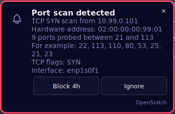
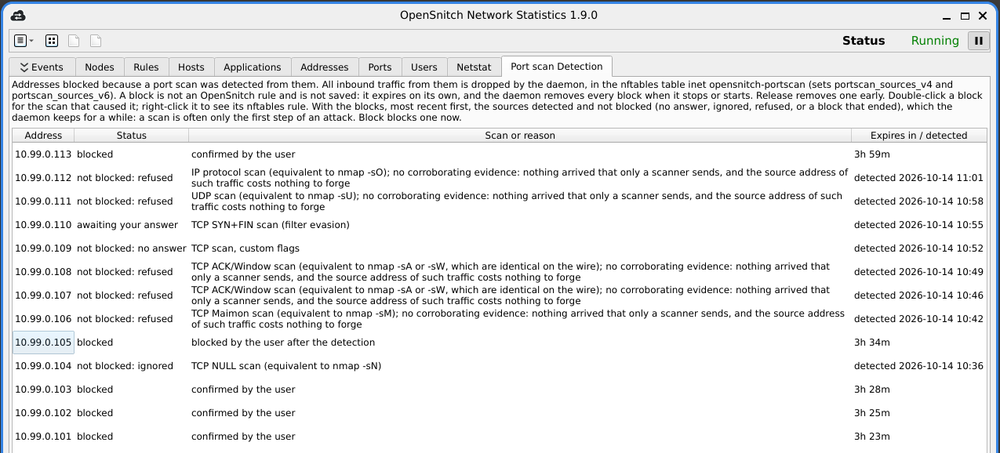

# Inbound port scan detection

OpenSnitch watches outbound connections. This feature watches the other
direction: it notices when something on the network is probing this machine,
says so, and can block the source for a while.

It answers [issue #1584](https://github.com/evilsocket/opensnitch/issues/1584).

**Pages**

- **Port Scan Detection**: what it does, and how to turn it on (this page)
- [Port Scan Detection: Settings](Port-Scan-Detection-Settings): every option, and the addresses that can never be blocked
- [Port Scan Detection: What It Costs](Port-Scan-Detection-Cost): measured per-packet cost, and what bounds it
- [Port Scan Detection: Limits](Port-Scan-Detection-Limits): what it does not detect, and why
- [Port Scan Detection: Coverage](Port-Scan-Detection-Coverage): the generated technique-by-technique table
- [Port Scan Detection: Verifying It Yourself](Port-Scan-Detection-Verifying): checking it on your own machine with real scans, the harnesses, and how to run them
- [Port Scan Detection: How It Works](Port-Scan-Detection-Internals): the implementation, for reviewers and contributors

## What it does

Every inbound packet is reduced to a small record (source, destination,
protocol, ports, TCP flags), and each source accumulates a score that leaks away
over time. Cross the threshold and a scan is reported.

The score is weighted by what the packet is, not merely counted:

| Packet | Why it weighs what it does |
|---|---|
| flags without ACK that are neither a plain SYN nor a plain RST (FIN, NULL, Xmas, SYN\|FIN, anything unusual) | unambiguous: a peer that believes it has a connection always acknowledges |
| a SYN to a port where nothing listens | the strongest ordinary evidence of probing |
| a SYN to a running service | what normal clients do; counted, barely |
| TCP carrying ACK (a bare ACK, FIN\|ACK) matching no known connection | may be a straggler from a socket that just closed |
| a UDP datagram to a closed port | trivially forged, and legitimate multi-port UDP is common |

A RST alone, or RST\|ACK, is a rejection and is not counted.

A port under 1024, or one of a short list of commonly attacked services above
it (RDP, databases, VNC, Redis, Docker), weighs more than another registered
port, which weighs more than an ephemeral one: scanning `22, 23, 25, 80` is
reconnaissance; four connections to high ports is a torrent client.

Being part of OpenSnitch is what makes the weighting possible. A network sensor
has to guess whether an inbound ACK is return traffic; here the daemon can look
at the host's own socket table and know. scanlogd and PortSentry both discard
every ACK and RST for exactly this reason.

Both IPv4 and IPv6 are handled throughout, including scans hidden behind IPv6
extension headers.

A detected scan is shown as a desktop notification (which, under the default
policy, offers to block the source) and recorded under **Rules** › **Alerts**
in the main window. Blocked sources are listed in the **Port scan Detection**
tab, and under **Rules** › **Port scan blocks**, where they can be released
early; a double-click on one shows the scan that caused the block, and its
context menu shows the nftables rule that applies it. The **Port scan
Detection** tab also lists, for 7 days, the sources detected and not blocked
(question unanswered or ignored, block refused, released or ended), with
their scan, and can block one after the fact: a scan is often only the
reconnaissance before an attack.

## What you see

A detected scan raises a notification. Under the default policy it asks
whether to block the source:



The **Port scan Detection** tab of the main window lists the blocks and the
sources detected and not blocked, most recent first. Double-click a row for
the details of the scan; right-click it to block it after the fact, release
it, delete it, or see the nftables rule of a block. See
[Settings](Port-Scan-Detection-Settings#what-happens-when-a-scan-is-detected).



## Turning it on

In `/etc/opensnitchd/default-config.json`, set `Enabled` to `true` in the
`PortScan` block (packages with this feature ship it set to `false`; add the
block if your file predates them, and keep only one `PortScan` key, since the
last one in the file wins):

```json
{
  "PortScan": {
    "Enabled": true
  }
}
```

Everything else has a default, and the block above is the whole of what you need
to write: any field you leave out keeps its shipped value. The feature is **off**
until you do this: a configuration that never mentions `PortScan` does not
enable it, and neither does upgrading the package.

The configuration is re-read whenever the file changes, so this takes effect
without restarting the daemon. Setting `"Enabled": false` later stops detection,
detaches the program and removes the firewall table.

The log says which packet source came up:

```
[IMPORTANT] [port scan] detection active (source: ebpf, block policy: ask, block duration: 4h0m0s)
```

If it says `afpacket` instead, the eBPF path was not available; the reason is
logged on the preceding line. Detection still works; it costs more CPU per
packet.

**The eBPF source needs Linux 6.6 or newer.** It attaches through TCX, which
arrived in 6.6 and is what lets OpenSnitch share an interface's ingress hook with
any other tool instead of taking exclusive ownership of it. On an older kernel
(Debian 12, RHEL 9, Ubuntu 22.04 without a recent HWE stack), attachment always
fails and detection runs on AF_PACKET. There is nothing to configure; it is the
kernel version.

It also needs `opensnitch-scan.o`, which packages built with this feature install
alongside the other eBPF modules; packages released before it do not have it.
The daemon looks for it in `/usr/lib/opensnitchd/ebpf`,
`/usr/local/lib/opensnitchd/ebpf` and `/etc/opensnitchd`, or only in the
directory named by `Ebpf.ModulesPath`, the existing top-level setting that the
other eBPF modules already use, not a key under `PortScan`. If you build from
source, `ebpf_prog/Makefile.scan` builds it without needing any kernel source:

```sh
cd ebpf_prog && make -f Makefile.scan
sudo install -m 644 opensnitch-scan.o /usr/lib/opensnitchd/ebpf/
```

That Makefile compiles with `-mcpu=v3`, because the per-source rate limiter uses
atomic instructions that return a value; without them the budget is not a bound
on a multi-core machine. Those need **clang 12 or newer** to emit and **Linux
5.12 or newer** to run, both well below the 6.6 that TCX attachment already
requires, so they cost no portability the attach method has not already spent.

The daemon refuses to load it from a directory that is writable by anyone but
root, and says so rather than falling back silently.

## Checking that it works

`utils/scripts/portscan-real-condition-test.sh` scans this machine with real
nmap scans from a network namespace of its own, so nothing goes on the network,
and says for each technique whether the daemon reported it as expected:

```sh
sudo utils/scripts/portscan-real-condition-test.sh -m quick 10.99.0.1
```

`quick` takes about five minutes; the default runs every technique, IPv4 and
IPv6. See [Verifying It Yourself](Port-Scan-Detection-Verifying#on-your-own-machine-with-real-scans).
